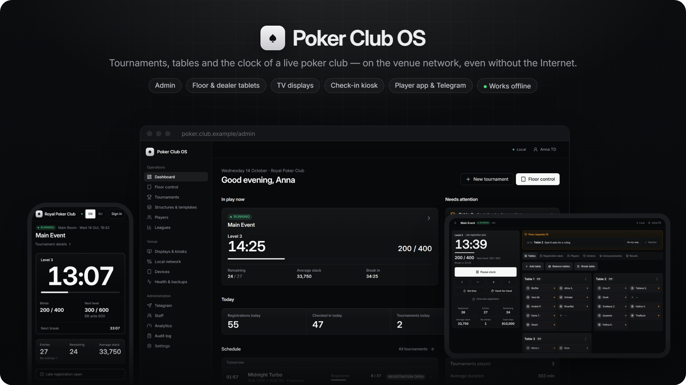
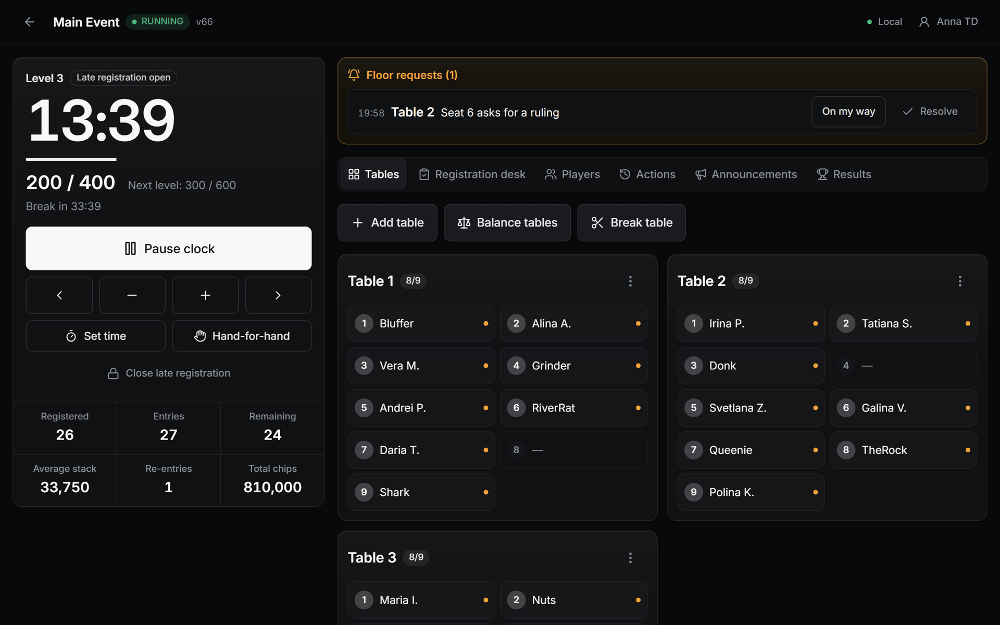
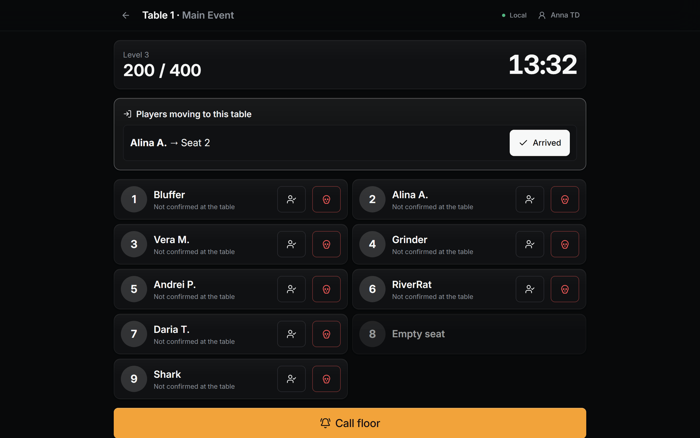
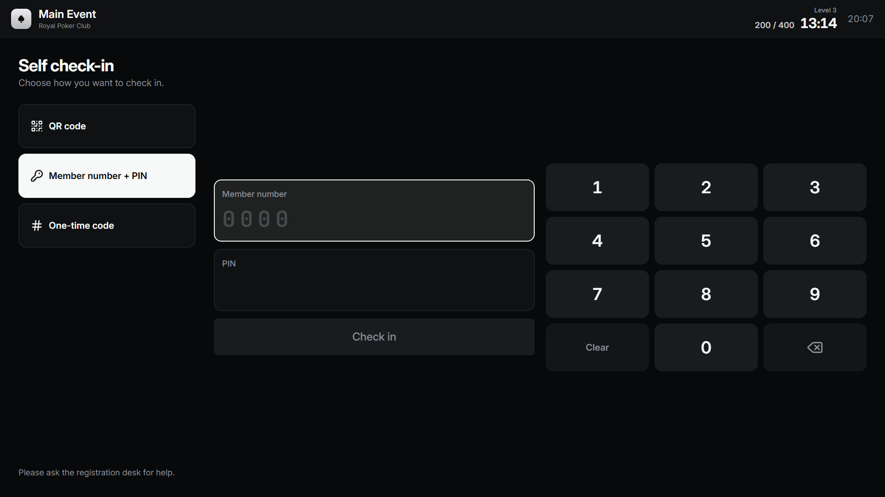
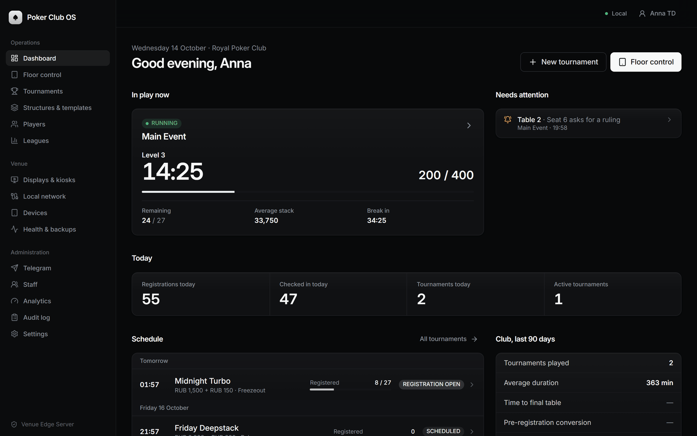
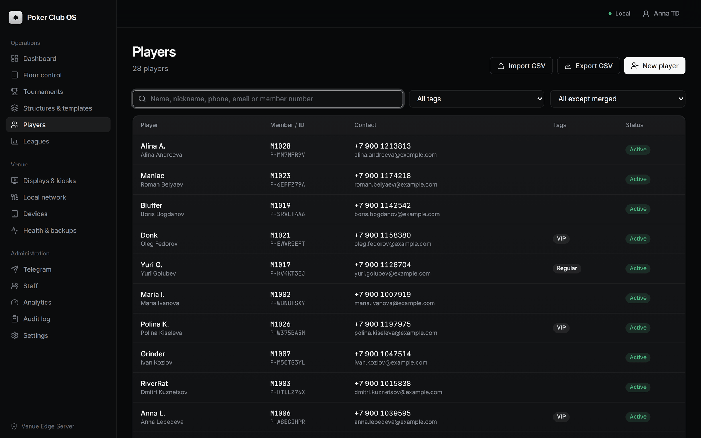
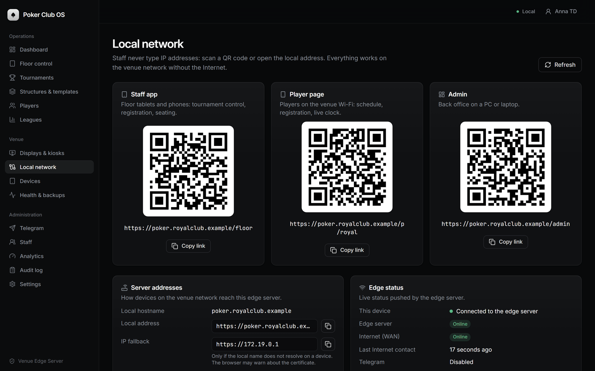
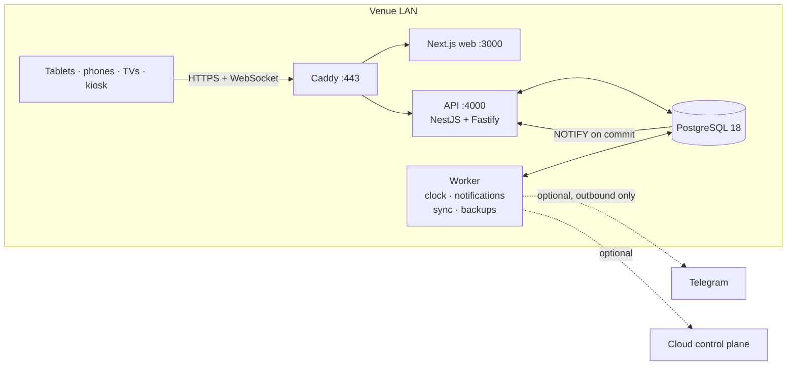

<p align="center">
  
</p>

<p align="center">
  <b>Local-first operating system for live poker clubs.</b><br>
  Registration, seating, the tournament clock, results and leagues — on the venue network, with or without the Internet.
</p>

<p align="center">
  <a href="https://github.com/kr0nsch/poker-club-os/actions/workflows/ci.yml"></a>
  
  
  
  
  
  
  
  <a href="LICENSE"></a>
</p>

<p align="center">
  <a href="#why-poker-club-os">Why</a> ·
  <a href="#features">Features</a> ·
  <a href="#screenshots">Screenshots</a> ·
  <a href="#architecture">Architecture</a> ·
  <a href="#quick-start">Quick start</a> ·
  <a href="#deploying-to-a-venue">Deploying</a> ·
  <a href="#documentation">Docs</a> ·
  <a href="README.md"><b>Русская версия</b></a>
</p>

---

## Why Poker Club OS

Live tournaments are run on paper sheets, spreadsheets and a clock app on a laptop — or on a cloud
service that stops the moment the venue Wi-Fi or the Internet drops. Poker Club OS takes a different
route: every club runs its own **Venue Edge Server**, a small PC on the club's LAN with PostgreSQL,
the API, a background worker and the web app. Tablets, TVs, the entrance kiosk and players' phones
all talk to that box over the local network.

<table>
  <tr>
    <td width="33%" valign="top"><b>Offline by design</b><br>The Internet is optional. Losing it only pauses Telegram, e-mail and cloud sync — never a running tournament.</td>
    <td width="33%" valign="top"><b>Realtime on every screen</b><br>Each committed change reaches every tablet, TV and phone over a local WebSocket within milliseconds.</td>
    <td width="33%" valign="top"><b>Safe floor operations</b><br>Every action is a validated command in one PostgreSQL transaction: optimistic concurrency, idempotency keys, audit trail, undo.</td>
  </tr>
  <tr>
    <td valign="top"><b>One server, every surface</b><br>Back office, floor and dealer tablets, TV displays, a self check-in kiosk, a player PWA, a Telegram bot and Mini App.</td>
    <td valign="top"><b>Self-hosted</b><br>One <code>docker compose</code> stack on an Ubuntu mini-PC, internal TLS via Caddy, scheduled backups, health dashboard.</td>
    <td valign="top"><b>Bilingual</b><br>The web UI and notifications in English and Russian, switchable per device.</td>
  </tr>
</table>

## Features

**Tournament director and floor**
- Blind structures and templates; freezeout, re-entry, rebuy and bounty formats; late registration, add-on and re-entry rules.
- Tournament clock with pause, level jumps, time adjustments, breaks and hand-for-hand.
- Random seat draw, table balancing and table breaks with moves confirmed by dealers.
- Eliminations (several players in one hand), re-entries, rebuys, add-ons, corrections with a reason and undo.
- Results, league points, seasons and public standings.

**Registration desk and cashier**
- Player search and quick creation, registration, waitlist, check-in with buy-in, re-entries and voids.
- Self check-in kiosk: registration QR code, member number + PIN, or a one-time code.

**Dealers**
- A tablet per table: seat presence, bust reports, "call floor", incoming player moves.

**Players**
- Mobile web app (PWA): schedule, self-registration, live clock, own seat, results, league standings, notifications.
- Telegram bot and Mini App: browse the schedule, register or cancel, see your seat, get alerts.
- TV displays with the clock, blinds, field statistics, seating during the draw and announcements.

**Club owner and operations**
- Player CRM: tags, staff notes, consents, CSV import and export, anonymization.
- Staff accounts with role-based access, device registry, append-only audit log.
- Analytics: check-in timing, registration funnel and channels, re-entry rate, retention.
- Health page, scheduled `pg_dump` backups with an optional off-site copy, optional cloud sync.

## Screenshots

<table>
  <tr>
    <td width="50%"><br><sub><b>Floor console</b> — clock, tables, floor calls, registration desk and results on one tablet.</sub></td>
    <td width="50%"><br><sub><b>Dealer tablet</b> — seats, bust reports, incoming moves and a big "Call floor" button.</sub></td>
  </tr>
  <tr>
    <td><br><sub><b>TV display</b> — clock, blinds and field statistics, readable across the room.</sub></td>
    <td><br><sub><b>Check-in kiosk</b> — QR code, member number + PIN or a one-time code.</sub></td>
  </tr>
  <tr>
    <td><br><sub><b>Dashboard</b> — what is in play, what needs attention, today's schedule.</sub></td>
    <td><br><sub><b>Tournament</b> — configuration with locked fields after the start and a live summary.</sub></td>
  </tr>
  <tr>
    <td><br><sub><b>Players</b> — CRM with tags, member numbers, CSV import and export.</sub></td>
    <td><br><sub><b>Analytics</b> — check-in timing, registration funnel, late registration, re-entries.</sub></td>
  </tr>
  <tr>
    <td><br><sub><b>Local network</b> — QR codes so staff and players never type an IP address.</sub></td>
    <td><br><sub><b>Health &amp; backups</b> — every component, Internet status and local backups.</sub></td>
  </tr>
</table>

<p align="center">
  <br>
  <sub><b>Player app</b> — schedule, live tournament and league standings on the venue Wi-Fi.</sub>
</p>

## Architecture



Every state change is an explicit, validated command executed in one PostgreSQL transaction with
optimistic concurrency, idempotency keys, an append-only audit trail and an outbox. Committed events
reach every screen through the local WebSocket hub. Details: [docs/ARCHITECTURE.md](docs/ARCHITECTURE.md),
[docs/REALTIME.md](docs/REALTIME.md), [docs/OFFLINE_OPERATION.md](docs/OFFLINE_OPERATION.md).

| Layer | Technology |
| --- | --- |
| Web | Next.js 16, React 19, Tailwind CSS 4, Radix UI, TanStack Query, React Hook Form |
| API and realtime | NestJS 12 on Fastify 5, WebSocket hub fed by PostgreSQL `LISTEN/NOTIFY` |
| Domain | Pure TypeScript rules (clock, late registration, seating and balancing, results, points, access control), Zod schemas shared by API and UI |
| Data | PostgreSQL 18, Drizzle ORM and SQL migrations, optional Redis |
| Edge | Docker Compose, Caddy (internal TLS), scheduled `pg_dump` backups |
| Tests | Vitest against embedded PostgreSQL, end-to-end suite with real API and worker processes |

### Repository layout

| Path | Contents |
| --- | --- |
| `apps/api` | HTTP API and realtime hub (NestJS on Fastify) |
| `apps/worker` | Background loops: clock ticker, WAN monitor, Telegram long polling, notifications, cloud sync, reminders, backups |
| `apps/web` | Next.js app: `/admin`, `/floor`, `/dealer`, `/p/{club}`, `/display/{token}`, `/kiosk/{token}`, `/tg/{club}`, `/setup` |
| `packages/types` | Shared Zod schemas, commands, permissions, realtime protocol, view types |
| `packages/domain` | Pure rules: clock, late registration, seating and balancing, results, points, access control |
| `packages/db` | Drizzle schema, SQL migrations, migration runner |
| `packages/core` | Services, command executor and handlers, notifications, Telegram bot, runners |
| `packages/telegram` | Bot API client, long poller, webhook and Mini App verification |
| `packages/ui` | UI components (Radix + Tailwind CSS 4) |
| `packages/testkit` | Embedded PostgreSQL for tests |
| `tests/e2e` | End-to-end suite with switchable Telegram, cloud and WAN mocks |
| `deploy/` | Caddyfile, install, backup and restore scripts |
| `docs/` | Product, architecture, operations and security documentation |

## Quick start

Requirements: **Node.js 24** and **pnpm 12**. No Docker and no system-wide PostgreSQL are needed for
development — an embedded PostgreSQL 18 is started for you.

```bash
git clone https://github.com/kr0nsch/poker-club-os.git
cd poker-club-os
pnpm install
pnpm dev
```

`pnpm dev` creates `.env` with fresh development secrets on the first run, starts the embedded
PostgreSQL (`.data/postgres`, port 54320), builds the shared packages and runs the API
(http://localhost:4000, applies migrations on start), the worker and the web app
(http://localhost:3000).

In a second terminal, load demo data — a club, staff accounts, 28 players, a running tournament, a
league, a TV display and a kiosk link:

```bash
pnpm seed:demo
```

| Demo account (development only) | Password |
| --- | --- |
| `td@royal.example` — tournament director | `correct-horse-battery` |
| `floor@`, `desk@`, `dealer@royal.example` | same |

Player pages: http://localhost:3000/p/royal. The TV display and kiosk links are printed by the seed script.

Checks:

```bash
pnpm typecheck
pnpm lint
pnpm test       # unit and integration tests against embedded PostgreSQL
pnpm test:e2e   # real API and worker: LAN operation, Internet outage, power loss, Telegram bot
```

> On a Windows workstation the whole toolchain can live in a portable `.venv/` folder (not committed):
> `. .\.venv\env.ps1` puts Node, pnpm, Git, Caddy, the Docker CLI and the PostgreSQL client tools on
> `PATH` for the current PowerShell session only.

## Deploying to a venue

On an Ubuntu LTS mini-PC with Docker, a fixed LAN address and a local DNS name such as
`poker.myclub.example`:

```bash
./deploy/scripts/install-edge.sh poker.myclub.example
```

1. The script creates `.env` with random secrets and starts PostgreSQL, Redis, API, worker, web and
   Caddy (internal TLS) with `docker compose`.
2. Open `https://poker.myclub.example/setup`, enter the setup token printed in `docker compose logs api`
   and create the club and the owner account.
3. Print the QR codes from **Admin → Local network** for staff and players; create TV and kiosk links in
   **Admin → Displays & kiosks**.
4. Optionally connect the Telegram bot in **Admin → Telegram**.

Step-by-step guides: [INSTALLATION_GUIDE](docs/INSTALLATION_GUIDE.md) ·
[EDGE_DEPLOYMENT](docs/EDGE_DEPLOYMENT.md) · [LOCAL_NETWORK](docs/LOCAL_NETWORK.md) ·
[DEVICE_SETUP](docs/DEVICE_SETUP.md) · [BACKUP_RECOVERY](docs/BACKUP_RECOVERY.md).

## Documentation

| Topic | Documents |
| --- | --- |
| Product | [PRODUCT](docs/PRODUCT.md) — roles, surfaces, the tournament workflow, feature flags |
| Design | [ARCHITECTURE](docs/ARCHITECTURE.md) · [DOMAIN_MODEL](docs/DOMAIN_MODEL.md) · [TOURNAMENT_STATE_MACHINE](docs/TOURNAMENT_STATE_MACHINE.md) · [SEATING_ENGINE](docs/SEATING_ENGINE.md) · [REALTIME](docs/REALTIME.md) · [API](docs/API.md) |
| Venue operations | [INSTALLATION_GUIDE](docs/INSTALLATION_GUIDE.md) · [LOCAL_NETWORK](docs/LOCAL_NETWORK.md) · [DEVICE_SETUP](docs/DEVICE_SETUP.md) · [OFFLINE_OPERATION](docs/OFFLINE_OPERATION.md) · [BACKUP_RECOVERY](docs/BACKUP_RECOVERY.md) |
| Deployment | [EDGE_DEPLOYMENT](docs/EDGE_DEPLOYMENT.md) · [DEPLOYMENT](docs/DEPLOYMENT.md) · [EDGE_CLOUD_SYNC](docs/EDGE_CLOUD_SYNC.md) |
| Security and data | [SECURITY](docs/SECURITY.md) · [NETWORK_SECURITY](docs/NETWORK_SECURITY.md) · [PRIVACY](docs/PRIVACY.md) |
| Integrations | [TELEGRAM](docs/TELEGRAM.md) |
| Decisions | [ASSUMPTIONS](docs/ASSUMPTIONS.md) — deviations from the original specification and known limitations |

## Scope

Poker Club OS runs the live tournament operation. It deliberately does **not** handle real money
(buy-ins are recorded for bookkeeping, the cashier takes payment physically), does not deal online
poker and has no payouts engine. Cash-game waitlists, time charge and memberships are not implemented
yet — see [PRODUCT § 7](docs/PRODUCT.md#7-intentionally-out-of-scope).

## License

Copyright © 2026 kr0nsch. All rights reserved. The source code is published for viewing and
evaluation only; using, copying, modifying or running it requires written permission. See
[LICENSE](LICENSE).
