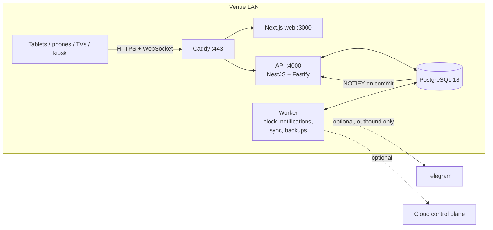

# Poker Club OS

Local-first operating system for live poker clubs. Every venue runs its own **Venue Edge Server** — a small
PC on the club's LAN with PostgreSQL, the API, a background worker and the web app. Registration,
check-in, seating, the tournament clock, eliminations, table balancing, results, league points, TV
displays, the entrance kiosk and the player app all work over the local network. The Internet is
optional: it is only needed for Telegram, e-mail and the optional cloud sync, and losing it never
stops a tournament.

- **Staff**: admin console, floor console for tablets, dealer tablet, desk/cashier flows.
- **Players**: mobile web app (PWA) with registration, live clock, seat and results; Telegram bot and Mini App.
- **Screens**: TV displays (clock, blinds, seating, results) and a self check-in kiosk.
- **Operations**: device registry, audit log, automatic backups, health dashboard, analytics.
- **Languages**: English and Russian throughout the UI.

## Architecture in one picture



Every state change is an explicit, validated command executed in one PostgreSQL transaction with
optimistic concurrency, idempotency keys, an append-only audit trail and an outbox. Committed events
reach every screen through a local WebSocket within milliseconds. Details: [docs/ARCHITECTURE.md](docs/ARCHITECTURE.md).

## Repository layout

| Path | Contents |
| --- | --- |
| `apps/api` | HTTP API and realtime hub (NestJS 12 on Fastify) |
| `apps/worker` | Background loops: clock ticker, WAN monitor, Telegram long polling, notification fan-out and delivery, cloud sync, reminders, backups |
| `apps/web` | Next.js 16 app: `/admin`, `/floor`, `/dealer`, `/p/{club}`, `/display/{token}`, `/kiosk/{token}`, `/tg/{club}`, `/setup` |
| `packages/types` | Shared Zod schemas, commands, permissions, realtime protocol, view types |
| `packages/domain` | Pure rules: clock, late registration, seating/balancing, results, points, access control |
| `packages/db` | Drizzle schema, SQL migrations, migration runner |
| `packages/core` | Services, command executor and handlers, notifications, Telegram bot, runners |
| `packages/telegram` | Bot API client, long poller, webhook/Mini App verification |
| `packages/ui` | UI components (Radix + Tailwind v4) |
| `packages/testkit` | Embedded PostgreSQL for tests |
| `tests/e2e` | End-to-end suite: real API + worker processes with switchable Telegram/cloud/WAN mocks |
| `deploy/` | Caddyfile, install/backup/restore scripts |
| `docs/` | Product, architecture, operations, security documentation |

## Development quick start

Requirements: Node.js 24 and pnpm 12. On the reference Windows workstation the whole toolchain is
portable and lives in `.venv/` (not committed): `. .\.venv\env.ps1` puts Node, pnpm, Git, Caddy, the Docker
CLI and the PostgreSQL client tools on `PATH` for the current PowerShell session only.

```bash
pnpm install
pnpm dev
```

`pnpm dev` creates `.env` with fresh development secrets on first run, starts an embedded PostgreSQL
(`.data/postgres`, UTF-8, port 54320), builds the shared packages and runs API (which applies the
migrations on start)
at http://localhost:4000, the worker and the web app at http://localhost:3000. In a second terminal, load demo data
(a club, staff accounts, 28 players, a running tournament, a league, a TV display and a kiosk link):

```bash
pnpm seed:demo
```

Demo sign-in (development only): `td@royal.example` / `correct-horse-battery` (also `floor@`, `desk@`,
`dealer@royal.example` with the same password). Player pages: http://localhost:3000/p/royal.

Checks:

```bash
pnpm typecheck
pnpm lint
pnpm test
pnpm test:e2e
```

`pnpm test` runs unit and integration tests against embedded PostgreSQL; `pnpm test:e2e` starts the
real API and worker and exercises LAN operation, realtime delivery, an Internet outage, power loss,
the Telegram bot (spec §91–95) and the complete final acceptance scenario of spec §103
(`tests/e2e/acceptance.test.ts`).

## Production (edge server)

On an Ubuntu LTS mini-PC with Docker:

```bash
./deploy/scripts/install-edge.sh poker.myclub.example
```

The script creates `.env` with random secrets and starts PostgreSQL, Redis, API, worker, web and Caddy
(internal TLS) with `docker compose`. Open `https://poker.myclub.example/setup`, enter the setup token
printed in the API log (`docker compose logs api`) and create the club and the owner account. Then
print the QR codes from **Admin → Local network** for staff and players. Full guides:
[docs/INSTALLATION_GUIDE.md](docs/INSTALLATION_GUIDE.md), [docs/EDGE_DEPLOYMENT.md](docs/EDGE_DEPLOYMENT.md),
[docs/LOCAL_NETWORK.md](docs/LOCAL_NETWORK.md), [docs/BACKUP_RECOVERY.md](docs/BACKUP_RECOVERY.md).

## Documentation

| Topic | Documents |
| --- | --- |
| Product | [PRODUCT](docs/PRODUCT.md) |
| Design | [ARCHITECTURE](docs/ARCHITECTURE.md), [DOMAIN_MODEL](docs/DOMAIN_MODEL.md), [TOURNAMENT_STATE_MACHINE](docs/TOURNAMENT_STATE_MACHINE.md), [SEATING_ENGINE](docs/SEATING_ENGINE.md), [REALTIME](docs/REALTIME.md), [API](docs/API.md) |
| Venue operations | [INSTALLATION_GUIDE](docs/INSTALLATION_GUIDE.md), [LOCAL_NETWORK](docs/LOCAL_NETWORK.md), [DEVICE_SETUP](docs/DEVICE_SETUP.md), [OFFLINE_OPERATION](docs/OFFLINE_OPERATION.md), [BACKUP_RECOVERY](docs/BACKUP_RECOVERY.md) |
| Deployment | [EDGE_DEPLOYMENT](docs/EDGE_DEPLOYMENT.md), [DEPLOYMENT](docs/DEPLOYMENT.md), [EDGE_CLOUD_SYNC](docs/EDGE_CLOUD_SYNC.md) |
| Security & data | [SECURITY](docs/SECURITY.md), [NETWORK_SECURITY](docs/NETWORK_SECURITY.md), [PRIVACY](docs/PRIVACY.md) |
| Integrations | [TELEGRAM](docs/TELEGRAM.md) |
| Decisions | [ASSUMPTIONS](docs/ASSUMPTIONS.md) — deviations from the specification and known limitations |

---

## Быстрый старт (RU)

**Poker Club OS** — система для живых покерных клубов, которая работает локально: в каждом клубе стоит
свой edge-сервер (мини-ПК в локальной сети). Регистрация, отметка игроков, рассадка, часы турнира,
вылеты, балансировка столов, результаты, лиги, TV-экраны и киоск работают без интернета. Интернет
нужен только для Telegram, почты и необязательной облачной синхронизации.

### Разработка (Windows, всё внутри `.venv`)

```powershell
. .\.venv\env.ps1
pnpm install
pnpm dev
```

При первом запуске создаётся `.env`, поднимается встроенный PostgreSQL (порт 54320), применяются
миграции и запускаются API (http://localhost:4000), воркер и веб-приложение (http://localhost:3000).
Демо-данные — во втором окне:

```powershell
. .\.venv\env.ps1
pnpm seed:demo
```

Вход для разработки: `td@royal.example` / `correct-horse-battery`. Страница игроков:
http://localhost:3000/p/royal. Интерфейс переключается между English и Русский в правом верхнем углу.

Проверки: `pnpm typecheck`, `pnpm lint`, `pnpm test`, `pnpm test:e2e`.

### Установка в клубе

1. Мини-ПК с Ubuntu LTS и Docker, фиксированный IP в локальной сети, имя вида `poker.myclub.example`
   в DNS роутера.
2. `./deploy/scripts/install-edge.sh poker.myclub.example` — создаёт `.env` со случайными секретами и
   запускает все сервисы.
3. Откройте `https://poker.myclub.example/setup`, введите токен первичной настройки из
   `docker compose logs api`, создайте клуб и учётную запись владельца.
4. **Админка → Локальная сеть**: распечатайте QR-коды для персонала и игроков; в разделе
   **Экраны и киоски** создайте ссылки для телевизоров и киоска.
5. По желанию подключите Telegram-бота в **Админка → Telegram**.

Подробно: [docs/INSTALLATION_GUIDE.md](docs/INSTALLATION_GUIDE.md) (пошаговая инструкция для техника),
[docs/OFFLINE_OPERATION.md](docs/OFFLINE_OPERATION.md) (что происходит без интернета),
[docs/BACKUP_RECOVERY.md](docs/BACKUP_RECOVERY.md) (резервные копии и восстановление).
