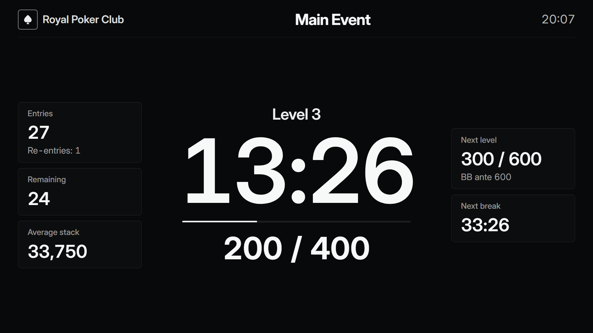
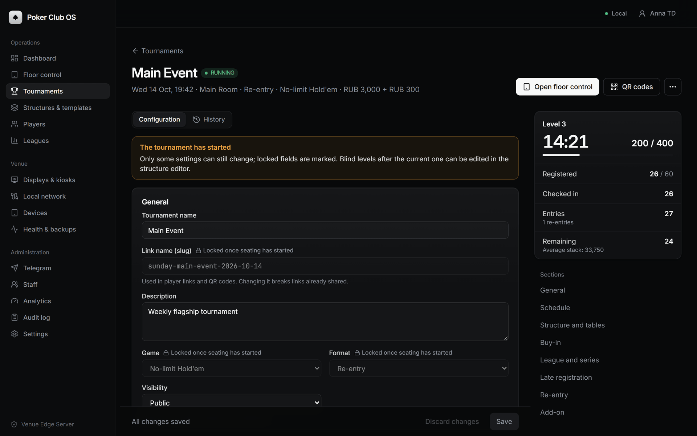
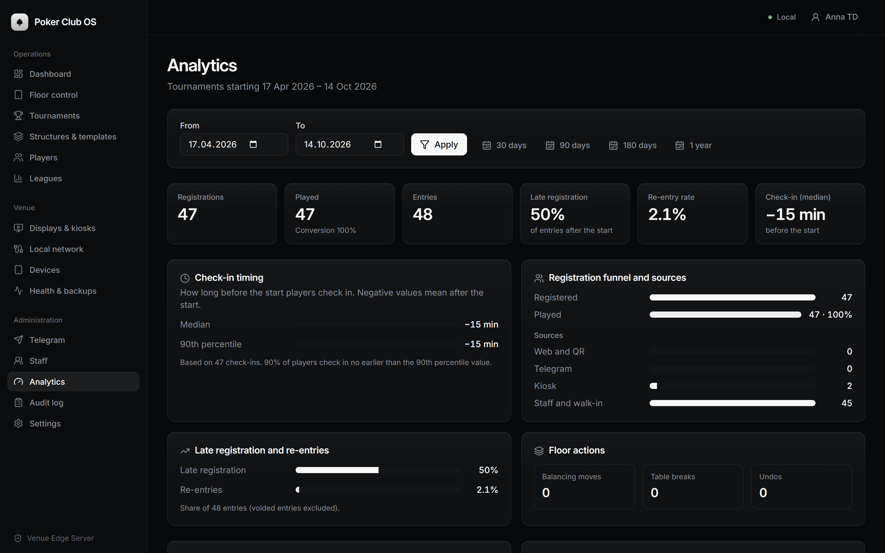
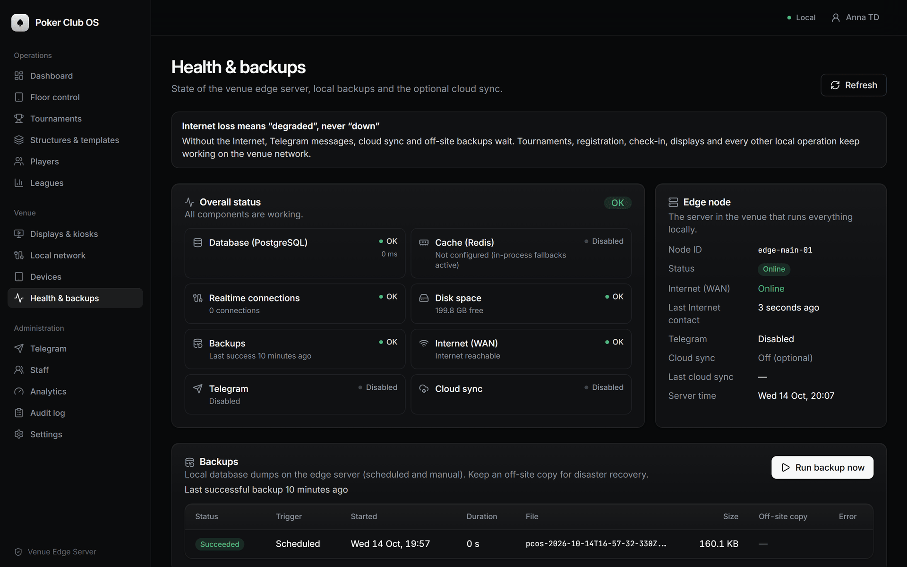
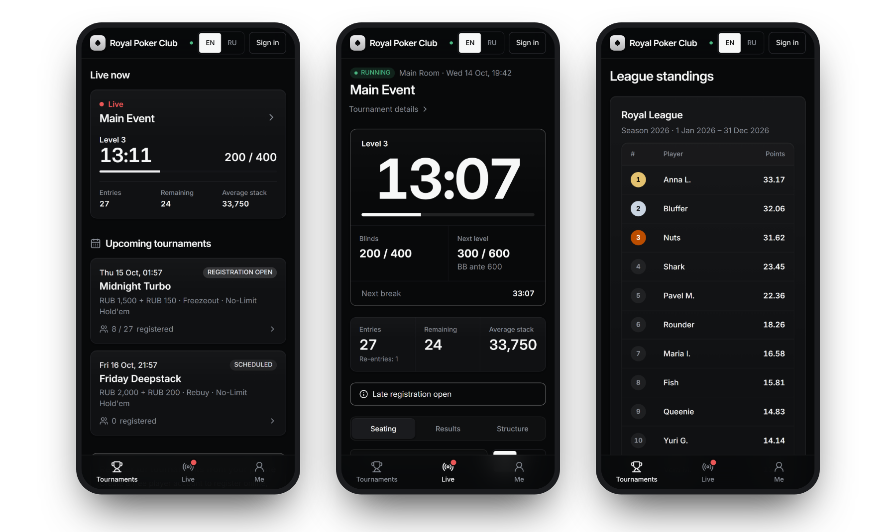
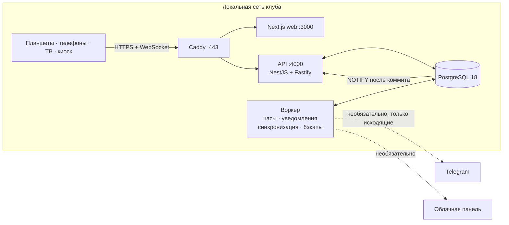

<p align="center">
  
</p>

<p align="center">
  <b>Локальная операционная система для живых покерных клубов.</b><br>
  Регистрация, рассадка, часы турнира, результаты и лиги — в сети клуба, с интернетом или без него.
</p>

<p align="center">
  
  
  
  
  
  
  
</p>

<p align="center">
  <a href="#зачем-poker-club-os">Зачем</a> ·
  <a href="#возможности">Возможности</a> ·
  <a href="#скриншоты">Скриншоты</a> ·
  <a href="#архитектура">Архитектура</a> ·
  <a href="#быстрый-старт">Быстрый старт</a> ·
  <a href="#установка-в-клубе">Установка</a> ·
  <a href="#документация">Документация</a> ·
  <a href="README.md"><b>English</b></a>
</p>

---

## Зачем Poker Club OS

Живые турниры обычно ведут на бумаге, в таблицах и в приложении-часах на ноутбуке — или в облачном
сервисе, который встаёт, как только в клубе пропадает Wi-Fi или интернет. Poker Club OS устроена
иначе: в каждом клубе работает свой **edge-сервер** — небольшой ПК в локальной сети клуба с
PostgreSQL, API, фоновым воркером и веб-приложением. Планшеты, телевизоры, киоск на входе и телефоны
игроков работают с ним напрямую по локальной сети.

<table>
  <tr>
    <td width="33%" valign="top"><b>Работает без интернета</b><br>Интернет не обязателен. Без него ждут только Telegram, почта и облачная синхронизация — идущий турнир не останавливается никогда.</td>
    <td width="33%" valign="top"><b>Мгновенно на всех экранах</b><br>Каждое изменение за миллисекунды доходит до всех планшетов, ТВ и телефонов через локальный WebSocket.</td>
    <td width="33%" valign="top"><b>Безопасные действия флора</b><br>Каждое действие — проверенная команда в одной транзакции PostgreSQL: оптимистичные блокировки, ключи идемпотентности, журнал аудита, отмена.</td>
  </tr>
  <tr>
    <td valign="top"><b>Один сервер — все экраны</b><br>Админка, планшеты флора и дилеров, ТВ-экраны, киоск самостоятельной отметки, PWA для игроков, Telegram-бот и Mini App.</td>
    <td valign="top"><b>Свой сервер</b><br>Один стек <code>docker compose</code> на мини-ПК с Ubuntu, внутренний TLS через Caddy, резервные копии по расписанию, панель здоровья.</td>
    <td valign="top"><b>Два языка</b><br>Веб-интерфейс и уведомления на русском и английском, язык выбирается на каждом устройстве.</td>
  </tr>
</table>

## Возможности

**Турнирный директор и флор**
- Структуры блайндов и шаблоны; форматы фризаут, ре-энтри, ребай и баунти; правила поздней регистрации, аддонов и ре-энтри.
- Часы турнира: пауза, переход между уровнями, корректировка времени, перерывы, hand-for-hand.
- Случайная рассадка, балансировка и закрытие столов с подтверждением пересадок дилерами.
- Вылеты (в том числе нескольких игроков в одной раздаче), ре-энтри, ребаи, аддоны, исправления с причиной и отменой.
- Результаты, очки лиги, сезоны и публичный рейтинг.

**Регистрация и касса**
- Поиск и быстрое создание игрока, регистрация, лист ожидания, отметка с бай-ином, ре-энтри и аннулирование.
- Киоск самостоятельной отметки: QR-код регистрации, номер участника + PIN или одноразовый код.

**Дилеры**
- Планшет на каждый стол: присутствие за местами, сообщения о вылетах, «вызов флора», входящие пересадки.

**Игроки**
- Мобильное веб-приложение (PWA): расписание, самостоятельная регистрация, живые часы, своё место, результаты, рейтинг лиги, уведомления.
- Telegram-бот и Mini App: расписание, регистрация и отмена, своё место, оповещения.
- ТВ-экраны с часами, блайндами, статистикой поля, рассадкой во время жеребьёвки и объявлениями.

**Владелец клуба и эксплуатация**
- CRM игроков: теги, заметки персонала, согласия, импорт и экспорт CSV, анонимизация.
- Учётные записи персонала с ролевым доступом, реестр устройств, неизменяемый журнал аудита.
- Аналитика: время отметки, воронка и каналы регистрации, доля ре-энтри, удержание.
- Страница здоровья, резервные копии `pg_dump` по расписанию с необязательной внешней копией, необязательная облачная синхронизация.

## Скриншоты

<table>
  <tr>
    <td width="50%"><br><sub><b>Консоль флора</b> — часы, столы, вызовы флора, регистрация и результаты на одном планшете.</sub></td>
    <td width="50%"><br><sub><b>Планшет дилера</b> — места, вылеты, входящие пересадки и большая кнопка «Вызвать флора».</sub></td>
  </tr>
  <tr>
    <td><br><sub><b>ТВ-экран</b> — часы, блайнды и статистика поля, читаются через весь зал.</sub></td>
    <td><br><sub><b>Киоск отметки</b> — QR-код, номер участника + PIN или одноразовый код.</sub></td>
  </tr>
  <tr>
    <td><br><sub><b>Панель управления</b> — что идёт сейчас, что требует внимания, расписание на сегодня.</sub></td>
    <td><br><sub><b>Турнир</b> — настройки с блокировкой полей после старта и живой сводкой.</sub></td>
  </tr>
  <tr>
    <td><br><sub><b>Игроки</b> — CRM с тегами, номерами участников, импортом и экспортом CSV.</sub></td>
    <td><br><sub><b>Аналитика</b> — время отметки, воронка регистрации, поздняя регистрация, ре-энтри.</sub></td>
  </tr>
  <tr>
    <td><br><sub><b>Локальная сеть</b> — QR-коды, чтобы персонал и игроки не вводили IP-адреса.</sub></td>
    <td><br><sub><b>Здоровье и бэкапы</b> — состояние компонентов, доступ в интернет, локальные копии.</sub></td>
  </tr>
</table>

<p align="center">
  <br>
  <sub><b>Приложение игрока</b> — расписание, живой турнир и рейтинг лиги через Wi-Fi клуба.</sub>
</p>

<sub>Скриншоты сделаны с английским интерфейсом; переключатель EN / RU есть на каждом экране.</sub>

## Архитектура



Каждое изменение состояния — явная проверенная команда, которая выполняется в одной транзакции
PostgreSQL с оптимистичной блокировкой, ключом идемпотентности, записью в журнал аудита и outbox.
Закоммиченные события доходят до всех экранов через локальный WebSocket-хаб. Подробнее:
[docs/ARCHITECTURE.md](docs/ARCHITECTURE.md), [docs/REALTIME.md](docs/REALTIME.md),
[docs/OFFLINE_OPERATION.md](docs/OFFLINE_OPERATION.md).

| Слой | Технологии |
| --- | --- |
| Веб | Next.js 16, React 19, Tailwind CSS 4, Radix UI, TanStack Query, React Hook Form |
| API и realtime | NestJS 12 на Fastify 5, WebSocket-хаб на PostgreSQL `LISTEN/NOTIFY` |
| Домен | Чистые правила на TypeScript (часы, поздняя регистрация, рассадка и балансировка, результаты, очки, доступ), общие Zod-схемы для API и UI |
| Данные | PostgreSQL 18, Drizzle ORM и SQL-миграции, необязательный Redis |
| Edge | Docker Compose, Caddy (внутренний TLS), резервные копии `pg_dump` по расписанию |
| Тесты | Vitest на встроенном PostgreSQL, сквозные тесты с настоящими процессами API и воркера |

### Структура репозитория

| Путь | Содержимое |
| --- | --- |
| `apps/api` | HTTP API и realtime-хаб (NestJS на Fastify) |
| `apps/worker` | Фоновые циклы: часы, мониторинг интернета, Telegram long polling, уведомления, синхронизация, напоминания, бэкапы |
| `apps/web` | Next.js: `/admin`, `/floor`, `/dealer`, `/p/{club}`, `/display/{token}`, `/kiosk/{token}`, `/tg/{club}`, `/setup` |
| `packages/types` | Общие Zod-схемы, команды, права, протокол realtime, типы представлений |
| `packages/domain` | Чистые правила: часы, поздняя регистрация, рассадка и балансировка, результаты, очки, доступ |
| `packages/db` | Схема Drizzle, SQL-миграции, запуск миграций |
| `packages/core` | Сервисы, исполнитель и обработчики команд, уведомления, Telegram-бот |
| `packages/telegram` | Клиент Bot API, long poller, проверка webhook и Mini App |
| `packages/ui` | UI-компоненты (Radix + Tailwind CSS 4) |
| `packages/testkit` | Встроенный PostgreSQL для тестов |
| `tests/e2e` | Сквозные тесты с переключаемыми заглушками Telegram, облака и интернета |
| `deploy/` | Caddyfile, скрипты установки, резервного копирования и восстановления |
| `docs/` | Документация по продукту, архитектуре, эксплуатации и безопасности |

## Быстрый старт

Нужны **Node.js 24** и **pnpm 12**. Docker и установленный в систему PostgreSQL для разработки не
нужны — встроенный PostgreSQL 18 запускается автоматически.

```bash
git clone https://github.com/kr0nsch/poker-club-os.git
cd poker-club-os
pnpm install
pnpm dev
```

При первом запуске `pnpm dev` создаёт `.env` со свежими секретами для разработки, поднимает
встроенный PostgreSQL (`.data/postgres`, порт 54320), собирает общие пакеты и запускает API
(http://localhost:4000, применяет миграции при старте), воркер и веб-приложение
(http://localhost:3000).

Во втором терминале загрузите демо-данные — клуб, сотрудников, 28 игроков, идущий турнир, лигу,
ТВ-экран и ссылку для киоска:

```bash
pnpm seed:demo
```

| Демо-аккаунт (только для разработки) | Пароль |
| --- | --- |
| `td@royal.example` — турнирный директор | `correct-horse-battery` |
| `floor@`, `desk@`, `dealer@royal.example` | такой же |

Страница игроков: http://localhost:3000/p/royal. Ссылки на ТВ-экран и киоск печатает скрипт демо-данных.

Проверки:

```bash
pnpm typecheck
pnpm lint
pnpm test       # модульные и интеграционные тесты на встроенном PostgreSQL
pnpm test:e2e   # настоящие API и воркер: работа в LAN, обрыв интернета, отключение питания, Telegram-бот
```

> На Windows весь инструментарий можно держать в переносной папке `.venv/` (не коммитится):
> `. .\.venv\env.ps1` добавляет Node, pnpm, Git, Caddy, Docker CLI и клиентские утилиты PostgreSQL в
> `PATH` только для текущей сессии PowerShell.

## Установка в клубе

Мини-ПК с Ubuntu LTS и Docker, фиксированный IP в локальной сети и локальное DNS-имя вида
`poker.myclub.example` в роутере:

```bash
./deploy/scripts/install-edge.sh poker.myclub.example
```

1. Скрипт создаёт `.env` со случайными секретами и запускает PostgreSQL, Redis, API, воркер, веб и
   Caddy (внутренний TLS) через `docker compose`.
2. Откройте `https://poker.myclub.example/setup`, введите токен первичной настройки из
   `docker compose logs api`, создайте клуб и учётную запись владельца.
3. **Админка → Локальная сеть**: распечатайте QR-коды для персонала и игроков; в разделе
   **Экраны и киоски** создайте ссылки для телевизоров и киоска.
4. По желанию подключите Telegram-бота в **Админка → Telegram**.

Пошаговые инструкции: [INSTALLATION_GUIDE](docs/INSTALLATION_GUIDE.md) (для техника) ·
[EDGE_DEPLOYMENT](docs/EDGE_DEPLOYMENT.md) · [LOCAL_NETWORK](docs/LOCAL_NETWORK.md) ·
[DEVICE_SETUP](docs/DEVICE_SETUP.md) · [OFFLINE_OPERATION](docs/OFFLINE_OPERATION.md) (что происходит без интернета) ·
[BACKUP_RECOVERY](docs/BACKUP_RECOVERY.md) (резервные копии и восстановление).

## Документация

Документация написана на английском.

| Тема | Документы |
| --- | --- |
| Продукт | [PRODUCT](docs/PRODUCT.md) — роли, экраны, ход турнира, флаги функций |
| Устройство | [ARCHITECTURE](docs/ARCHITECTURE.md) · [DOMAIN_MODEL](docs/DOMAIN_MODEL.md) · [TOURNAMENT_STATE_MACHINE](docs/TOURNAMENT_STATE_MACHINE.md) · [SEATING_ENGINE](docs/SEATING_ENGINE.md) · [REALTIME](docs/REALTIME.md) · [API](docs/API.md) |
| Работа клуба | [INSTALLATION_GUIDE](docs/INSTALLATION_GUIDE.md) · [LOCAL_NETWORK](docs/LOCAL_NETWORK.md) · [DEVICE_SETUP](docs/DEVICE_SETUP.md) · [OFFLINE_OPERATION](docs/OFFLINE_OPERATION.md) · [BACKUP_RECOVERY](docs/BACKUP_RECOVERY.md) |
| Развёртывание | [EDGE_DEPLOYMENT](docs/EDGE_DEPLOYMENT.md) · [DEPLOYMENT](docs/DEPLOYMENT.md) · [EDGE_CLOUD_SYNC](docs/EDGE_CLOUD_SYNC.md) |
| Безопасность и данные | [SECURITY](docs/SECURITY.md) · [NETWORK_SECURITY](docs/NETWORK_SECURITY.md) · [PRIVACY](docs/PRIVACY.md) |
| Интеграции | [TELEGRAM](docs/TELEGRAM.md) |
| Решения | [ASSUMPTIONS](docs/ASSUMPTIONS.md) — отступления от исходной спецификации и известные ограничения |

## Границы продукта

Poker Club OS ведёт живые турниры. Система намеренно **не** работает с реальными деньгами (бай-ины
записываются для учёта, оплату принимает кассир), не является онлайн-покером и не рассчитывает
выплаты. Листы ожидания кэш-игр, почасовая оплата и членство пока не реализованы — см.
[PRODUCT § 7](docs/PRODUCT.md#7-intentionally-out-of-scope).
