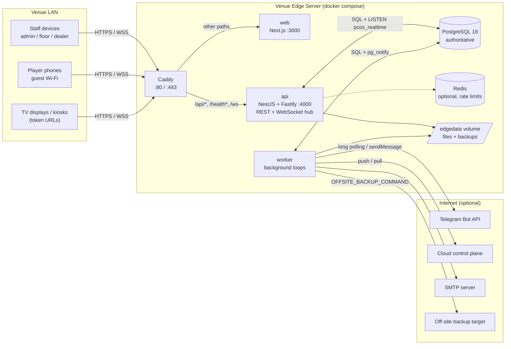

# Architecture

Poker Club OS runs as a **Venue Edge Server**: one small computer (mini-PC) per venue runs the complete
stack. PostgreSQL on that machine is the single source of truth for everything that happens on the
floor. Staff tablets, player phones, TV displays and kiosks talk to the edge server over the venue LAN.
The Internet is optional: it is only needed for Telegram, e-mail, the optional cloud sync and
(optionally) ACME certificates. Live tournament commands never wait for an external system.

Related documents: [DOMAIN_MODEL.md](DOMAIN_MODEL.md), [TOURNAMENT_STATE_MACHINE.md](TOURNAMENT_STATE_MACHINE.md),
[SEATING_ENGINE.md](SEATING_ENGINE.md), [REALTIME.md](REALTIME.md), [API.md](API.md),
[LOCAL_NETWORK.md](LOCAL_NETWORK.md), [EDGE_DEPLOYMENT.md](EDGE_DEPLOYMENT.md),
[EDGE_CLOUD_SYNC.md](EDGE_CLOUD_SYNC.md), [OFFLINE_OPERATION.md](OFFLINE_OPERATION.md),
[TELEGRAM.md](TELEGRAM.md), [SECURITY.md](SECURITY.md), [BACKUP_RECOVERY.md](BACKUP_RECOVERY.md).

---

## 1. Runtime topology

The production stack is defined in `docker-compose.yml` (one `Dockerfile` with the targets `api`,
`worker`, `web`). Only the reverse proxy publishes ports on the venue network; every other service is
reachable only on the internal Docker network `edge` (`172.28.0.0/24`).

| Service | Image / source | Port (internal) | Role |
|---|---|---|---|
| `postgres` | `postgres:18-bookworm` | 5432 | Authoritative database (UTF-8 enforced at init and at migration time). |
| `redis` | `redis:8-alpine` | 6379 | Optional. No persistence (`--save ""`, `--appendonly no`). Used only by the rate limiter; every consumer falls back to in-process state when `REDIS_URL` is empty or Redis is unreachable. |
| `api` | `apps/api` | 4000 | REST API (NestJS on Fastify) and the local WebSocket hub. |
| `worker` | `apps/worker` | – | Background loops (clock ticker, notifications, Telegram polling, sync, backups). Image includes `pg_dump` 18. |
| `web` | `apps/web` | 3000 | Next.js standalone server: staff, player, display and kiosk UIs. |
| `proxy` | `caddy:2` | 80 / 443 (published) | TLS termination and routing. |
| `minio` | `minio/minio` | – | Optional (`--profile storage`). No S3 storage adapter exists in the code; see "Storage" below. |

Volumes: `pgdata` (database), `edgedata` (`/data/files` uploaded CSV imports, `/data/backups` dumps;
shared by `api` and `worker`), `caddy_data`, `caddy_config`.

### Reverse proxy routing (`deploy/caddy/Caddyfile`)

| Path | Upstream |
|---|---|
| `/api/*`, `/health`, `/health/*` | `api:4000` (this includes the alternative WebSocket path `/api/v1/ws`) |
| `/ws` | `api:4000` with `flush_interval -1` (local WebSocket) |
| everything else | `web:3000` |

TLS is selected by `CADDY_TLS`: `internal` (Caddy's local CA), a certificate/key pair mounted under
`/certs`, or an e-mail address for ACME. Caddy adds HSTS and `X-Content-Type-Options`, removes the
`Server` header and uses a 5-minute idle timeout for long-lived WebSockets. Hostnames and DNS are
covered in [LOCAL_NETWORK.md](LOCAL_NETWORK.md); deployment steps in [EDGE_DEPLOYMENT.md](EDGE_DEPLOYMENT.md).

The Next.js app also rewrites `/api/*` and `/health*` to `API_ORIGIN` (default
`http://127.0.0.1:4000`) so that `next dev` / `next start` work without Caddy. It does not rewrite
`/ws`; in development the browser connects to `NEXT_PUBLIC_WS_URL` (`ws://localhost:4000/ws` in
`apps/web/.env.development`).

### Component diagram



---

## 2. Monorepo layout

pnpm workspace (`apps/*`, `packages/*`, `tests/*`) built with Turborepo. Node.js ≥ 24, TypeScript,
ES modules throughout.

| Path | Package | Owns |
|---|---|---|
| `apps/api` | `@pcos/api` | Process entry (`main.ts`), Fastify/NestJS server (`server.ts`), controllers (`controllers/*.ts`), request guard (CSRF, Origin, session, device revocation, per-IP limit), error filter, WebSocket hub (`realtime/hub.ts`). Contains no business rules; controllers call `@pcos/core`. |
| `apps/worker` | `@pcos/worker` | Process entry that migrates (optional), registers the edge node and calls `startWorkerLoops`. |
| `apps/web` | `@pcos/web` | Next.js 16 / React 19 UI: `/admin/*`, `/floor`, `/dealer`, `/display/[token]`, `/kiosk/[token]`, `/p/[org]/*` (player pages), `/tg/[org]` (Telegram Mini App), `/login`, `/setup`. Realtime client in `src/lib/realtime*.ts`. |
| `packages/types` | `@pcos/types` | Shared enums, permissions and role defaults, error codes, zod input schemas (including the tournament command catalogue `schemas/commands.ts`), read-model view types, realtime protocol types. Depends only on `zod`. |
| `packages/domain` | `@pcos/domain` | Pure, I/O-free rules: tournament state machine, clock derivation, registration/entry rules, seating/balancing/table-break planners, standings, league scoring and formula language, notification TTL/retry policy, sync decisions, undo mapping, statistics, subscription authorization, CSPRNG and seeded RNG. |
| `packages/db` | `@pcos/db` | Drizzle schema (`schema.ts`), SQL migrations (`drizzle/`), connection pool, migrator (advisory-locked), system role seeding, `migrate` CLI. |
| `packages/core` | `@pcos/core` | Application layer used by API, worker and tests: configuration, composition root (`app.ts`), command executor and handlers, services (auth, org, players, structures, tournaments, leagues, displays, devices, edge, sync, backups, reports, imports, announcements), notification pipeline, Telegram bot logic, background runners, outbox/`pg_notify` publishing, audit writing. |
| `packages/telegram` | `@pcos/telegram` | Dependency-free Telegram Bot API client, long-polling loop, webhook-secret and Mini App `initData` verification, message formatting helpers. |
| `packages/ui` | `@pcos/ui` | React component primitives (Radix-based buttons, forms, overlays, layout, table). |
| `packages/testkit` | `@pcos/testkit` | Test infrastructure: embedded PostgreSQL cluster, migrated template database, per-test-file database clones. |
| `packages/config` | `@pcos/config` | Shared `tsconfig` presets and ESLint configuration. |
| `tests/e2e` | `@pcos/e2e` | End-to-end tests that spawn the built `api` and `worker` processes against embedded PostgreSQL with mocked Telegram, cloud and WAN probes (`lan`, `restart`, `telegram`, `wan-recovery`). |

Dependency direction (runtime packages): `types` ← `domain` ← `core`; `types` ← `db` ← `core`;
`telegram` ← `core`; `core` ← `api`, `worker`. The web app depends on `types`, `domain` (clock
derivation, offset estimation) and `ui` only; it never imports `core` or `db`.

---

## 3. Composition and configuration

`createCore(config)` in `packages/core/src/app.ts` builds one container with a PostgreSQL pool, an
optional Redis handle, a `SecretBox` (AES-256-GCM for integration secrets, key from
`SECRETS_ENCRYPTION_KEY` or derived from `SESSION_SECRET`), a rate limiter (Redis or in-memory),
local file storage, the command executor and all services. Both processes create their own container;
the API wraps it in NestJS providers.

Configuration is read from environment variables and validated by zod (`packages/core/src/config.ts`);
invalid configuration stops the process. `redactedConfig` removes every key matching
`SECRET|TOKEN|PASSWORD|KEY|DATABASE_URL|REDIS_URL|DSN` for diagnostics.

Start-up (both processes): if `AUTO_MIGRATE` (default `true`), apply migrations under
`pg_advisory_lock(727001)` and upsert system roles; then `EdgeService.ensureNode()` registers or
refreshes the `venue_edge_nodes` row for `EDGE_NODE_ID`. The API additionally prints a one-time setup
token to its console while no user exists. Both processes handle `SIGTERM`/`SIGINT` with a 15 s forced
exit.

### Storage

Only `LocalFileStorage` (`STORAGE_DIR`) is implemented; it is used for uploaded CSV imports. The
variables `S3_ENDPOINT`, `S3_BUCKET`, `S3_ACCESS_KEY`, `S3_SECRET_KEY`, `SENTRY_DSN` and `LOG_LEVEL`
are parsed but not used by any code path (not implemented).

---

## 4. Process responsibilities

### API process (`apps/api`)

| Responsibility | Where |
|---|---|
| REST endpoints under `/api/v1` and `/health` | `controllers/*.ts` → core services ([API.md](API.md)) |
| Request guard: per-IP limit (1500 req / 60 s), session cookie resolution, Origin check and `X-CSRF-Token` for state-changing methods, staff device registration/revocation | `http/context.guard.ts` |
| Error mapping to `{error:{code,message,details?,currentVersion?}}` | `http/error.filter.ts` |
| Local WebSocket hub on `/ws` and `/api/v1/ws` | `realtime/hub.ts` ([REALTIME.md](REALTIME.md)) |
| `LISTEN pcos_realtime` with automatic reconnect; forwards committed events to sockets | `RealtimeListener` (`packages/core/src/runners/realtime-listener.ts`) |
| Telegram webhook endpoint (`CLOUD_WEBHOOK` mode only) | `CommunicationController.webhook` |

The API process does not run any periodic business loop other than the hub's heartbeat (25 s) and
session revalidation (60 s).

### Worker process (`apps/worker`, `packages/core/src/runners/worker.ts`)

| Loop | Interval (default) | What it does |
|---|---|---|
| Clock ticker | 500 ms | For every clock in `RUNNING`, checks whether the derived level differs from the persisted one and calls `executor.autoAdvance()` to materialise the level change (see [TOURNAMENT_STATE_MACHINE.md](TOURNAMENT_STATE_MACHINE.md#4-clock-model)). |
| WAN monitor | `WAN_PROBE_INTERVAL_MS` = 15 s | `HEAD` requests to `WAN_PROBE_URLS`; any HTTP response means online. Persists `ONLINE`/`DEGRADED` on the edge node and broadcasts `edge.status.updated` on change. When the WAN returns it wakes Telegram pollers, runs one dispatch and one cloud push, and enqueues an "Internet restored" staff alert. |
| Telegram long polling | reconcile every `min(15 s, 5 × DISPATCH_INTERVAL_MS)` | One `LongPoller` per enabled bot in `EDGE_LONG_POLLING` mode, guarded by a PostgreSQL session advisory lock keyed on the bot id so only one worker polls a token. Offsets are persisted in `telegram_integrations.last_update_id`. |
| Notification fan-out | `FANOUT_INTERVAL_MS` = 1 s (up to 20 batches of 200 per tick) | Reads `outbox_events` after the `notification-fanout` cursor and enqueues `notifications` rows; batch and cursor advance commit in one transaction. |
| Notification dispatch | `DISPATCH_INTERVAL_MS` = 2 s | Expires stale rows, defers everything while the WAN is down, claims due rows (`FOR UPDATE SKIP LOCKED`, status `SENDING`), sends outside any transaction, records the outcome with retry/backoff. Rows stuck in `SENDING` for > 2 min are returned to `PENDING` at worker start. |
| Cloud push | `SYNC_PUSH_INTERVAL_MS` = 10 s | Only when sync is enabled and the WAN is online: sends up to 200 syncable outbox events (≤ 512 KiB) to `CLOUD_API_URL/v1/edge/events`. |
| Cloud pull | `SYNC_PULL_INTERVAL_MS` = 60 s | Same conditions: fetches `/v1/edge/changes` and applies non-conflicting player/tournament changes ([EDGE_CLOUD_SYNC.md](EDGE_CLOUD_SYNC.md)). |
| Reminders | 60 s | `TOURNAMENT_REMINDER` for registrations of tournaments starting within 2 h; `LATE_REGISTRATION_CLOSING` to Telegram subscribers 1–10 min before a level-based late registration closes. |
| Backups | 60 s | Runs a requested backup, or a scheduled one every `BACKUP_SCHEDULE_HOURS` (default 6; `0` disables): `pg_dump --format=custom`, optional `OFFSITE_BACKUP_COMMAND`, keeps `BACKUP_RETENTION` files ([BACKUP_RECOVERY.md](BACKUP_RECOVERY.md)). |
| Heartbeat | 30 s | `ensureNode()` refreshes `last_seen_at` of the edge node. |
| Housekeeping | 6 h | Deletes sessions expired/revoked > 7 days, Telegram link tokens expired > 1 day, update receipts > 30 days, finished notifications > 90 days, and outbox rows > 30 days old that are `SYNCED`/`SKIPPED` and already consumed by the fan-out. Never touches `audit_logs`. |

Every loop is guarded against overlapping runs; an exception is logged and the loop continues.
None of these loops is on the critical path of a tournament command: if the worker is down, commands
still succeed and broadcast; only automatic level changes are not persisted (clients keep deriving the
countdown locally from the anchor) and notifications/sync wait in the database.

Note: the header comment of `packages/core/src/infra/singleton-lock.ts` says the advisory-lock
singleton is also used for the clock ticker and the cloud push; in the code only Telegram polling uses
it. Running two workers would run two tickers; `autoAdvance` is idempotent under the tournament row
lock.

---

## 5. Request flow of a tournament command

All live tournament mutations go through one endpoint,
`POST /api/v1/tournaments/:id/commands`, and one class, `TournamentCommandExecutor`
(`packages/core/src/tournaments/executor.ts`). Player self-registration, kiosk check-in and Telegram
bot actions call the same executor with a player or system actor.

1. **Guard** (`ContextGuard`): per-IP rate limit, session cookie → staff principal, Origin check,
   `X-CSRF-Token` check, device revocation check. The command route requires a staff session.
2. **Validate**: the body is parsed with the discriminated union `TournamentCommand`
   (`type`, `payload`, `expectedVersion`, `clientOperationId`). Invalid → `400 VALIDATION_ERROR`.
3. **Authorize**: staff need `COMMAND_PERMISSIONS[type]`; players may only issue `REGISTER_PLAYER`
   and `CANCEL_REGISTRATION` (ownership checked by the handler); display/kiosk principals cannot issue
   commands.
4. **Idempotency pre-check**: `operational_actions` is looked up by
   `(organization_id, client_operation_id)`. Same request hash → the stored result is returned with
   `duplicate: true`; different hash → `409 IDEMPOTENCY_MISMATCH`.
5. **Transaction**: `BEGIN`, `SELECT … FROM tournaments … FOR UPDATE` (serialises all commands of one
   tournament), tenant/venue access check, idempotency re-check under the lock, version checks
   (`expectedVersion` ahead of the server, or `STRICT` command on a different version →
   `409 VERSION_CONFLICT`).
6. **Clock materialisation**: levels, clock row and organization feature flags are loaded; if the
   running clock has passed a level boundary the anchor is advanced first (and `RUNNING`/`BREAK`
   status aligned).
7. **Handler**: the command-specific handler (`handlers/*.ts`) reads and writes rows inside the same
   transaction through a `CommandContext`, declaring touched entity keys, events, audit entries and a
   summary.
8. **REBASE check**: if `expectedVersion` is older than the current version, any
   `operational_actions` row with `result_version > expectedVersion` whose `affected_keys` overlap the
   keys touched now causes `409 VERSION_CONFLICT`. A stale command whose handler raised
   `INVALID_STATE` is also reported as `VERSION_CONFLICT`.
9. **Persist effects**: tournament `version + 1` and patched fields, clock row (if changed),
   `operational_actions` row (idempotency key, request hash, payload, result, affected keys, summary,
   result version, compensation links), `audit_logs` rows, `outbox_events` rows and one
   `pg_notify('pcos_realtime', …)` per realtime event.
10. **Commit**. PostgreSQL delivers the notifications only after commit, so a rolled-back command
    never broadcasts.
11. **Fan-out**: every API process holds a `LISTEN pcos_realtime` connection and pushes the event to
    authorised WebSocket subscribers; the worker later consumes the same outbox rows for notifications
    and cloud sync.

No external request is made inside the transaction.

```mermaid
sequenceDiagram
  autonumber
  participant C as Floor tablet
  participant P as Caddy
  participant G as API guard + controller
  participant X as Command executor
  participant DB as PostgreSQL
  participant H as WebSocket hub (every API process)
  participant O as Other devices
  participant W as Worker
  C->>P: POST /api/v1/tournaments/:id/commands
  P->>G: proxy (X-Forwarded-For)
  G->>G: rate limit, session, Origin, X-CSRF-Token, device
  G->>X: execute(id, body, staff actor)
  X->>X: zod parse, permission check
  X->>DB: find operational_actions by clientOperationId
  X->>DB: BEGIN; SELECT tournament FOR UPDATE
  X->>DB: idempotency re-check, version checks
  X->>DB: load levels, clock, flags; materialise auto-advance
  X->>DB: handler reads/writes (registrations, entries, seats, ...)
  X->>DB: REBASE overlap check (stale expectedVersion only)
  X->>DB: UPDATE tournaments (version+1), clock state
  X->>DB: INSERT operational_actions, audit_logs, outbox_events
  X->>DB: SELECT pg_notify('pcos_realtime', event)
  X->>DB: COMMIT
  DB-->>H: NOTIFY delivered after commit
  X-->>G: CommandResult
  G-->>C: 200 {actionId, tournamentVersion, duplicate, result}
  H-->>O: {type:"event", event} (authorised subscribers)
  H-->>C: same event
  W->>DB: fan-out reads outbox_events → notifications
```

Payloads larger than 7 500 bytes are sent by reference (`{"ref": seq}`) and re-read from
`outbox_events` by the listener (`pg_notify` payloads are limited to 8 000 bytes).

---

## 6. Data ownership and consistency rules

- **PostgreSQL is authoritative.** Redis holds only rate-limit counters; process memory holds caches
  (edge status 2 s, device revocation 60 s, subscription targets 10 s, session touch throttle).
- **Optimistic concurrency** via integer `version` columns and `expectedVersion`
  ([DOMAIN_MODEL.md](DOMAIN_MODEL.md#3-cross-cutting-conventions)); command concurrency modes are
  listed in [API.md](API.md#7-tournament-command-catalogue).
- **Append-only history**: `audit_logs` is protected by triggers (`0001_audit_append_only.sql`);
  `operational_actions`, `seat_movements` and `entry_transactions` are only ever inserted into, with
  corrections as new rows (not enforced by triggers).
- **Durable outbox**: every domain event is written to `outbox_events` in the state-changing
  transaction; realtime delivery, notification fan-out and cloud sync all read from it.
- **Time**: all timestamps are `timestamptz`; the clock is anchored to wall-clock instants, and clients
  correct their own clock with the server offset measured over the WebSocket.

---

## 7. Failure behaviour (summary)

| Failure | Effect |
|---|---|
| Internet down | Edge status `DEGRADED`; Telegram/e-mail notifications stay `PENDING` (network outages do not consume attempts) and expire by type-specific TTL; cloud push/pull pause. Local operation unaffected. See [OFFLINE_OPERATION.md](OFFLINE_OPERATION.md). |
| Worker down | Commands and realtime still work. Level changes are not persisted until the worker returns (derived clocks keep counting); notifications, sync, backups wait. |
| API `LISTEN` connection lost | Reconnects with backoff 0.5 s → 10 s; after reconnect every socket receives a `resync` event and clients reload snapshots. |
| Redis down | Rate limiting falls back to per-process memory. |
| Edge server power loss | State is in PostgreSQL. The clock anchor is wall-clock based, so after restart the ticker materialises the levels that elapsed during the outage; commands retried with the same `clientOperationId` apply once (covered by `tests/e2e/restart.test.ts`). |
