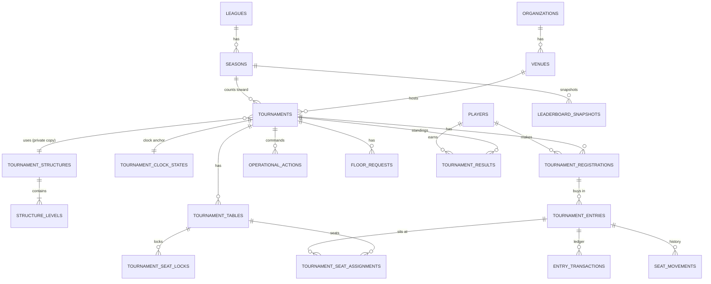

# Domain model

Source of truth: `packages/db/src/schema.ts` (Drizzle schema, 57 tables; migrations in
`packages/db/drizzle/`) and `packages/types/src` (enums, input schemas, read models). Pure rules that
operate on this model live in `packages/domain`; see [TOURNAMENT_STATE_MACHINE.md](TOURNAMENT_STATE_MACHINE.md)
and [SEATING_ENGINE.md](SEATING_ENGINE.md). Architecture context: [ARCHITECTURE.md](ARCHITECTURE.md).

Conventions used below:

- Columns are `snake_case` in PostgreSQL and `camelCase` in TypeScript (Drizzle `casing: "snake_case"`).
- Primary keys are UUIDs (`gen_random_uuid()` default) unless stated otherwise.
- Enumerations are `text` columns; where the table defines a `CHECK` constraint it is marked "(CHECK)".
  Other enumerations are only validated by application code.
- "FK" means a declared foreign key; "ref" means a logical reference without a database constraint.

---

## 1. Core tournament entities

---

## 2. Entities by area

### 2.1 Tenancy and edge

| Table | Key columns | Notes |
|---|---|---|
| `organizations` | `name`, `slug` (unique) | The tenant. Everything tenant-owned references it. |
| `organization_settings` | PK `organization_id`; `locale` (default `en`), `timezone` (`Europe/Berlin`), `currency` (`EUR`), `feature_flags` jsonb, `notification_types` jsonb, `version` | Feature flags are merged over `DEFAULT_FEATURE_FLAGS` (`packages/types/src/enums.ts`). `notification_types[type] = false` disables a notification type for the organization. |
| `venues` | `organization_id` FK, `name`, `slug` (unique per org), `timezone`, `address`, `local_hostname`, `local_url`, `public_url`, `version` | A physical club. Staff may be restricted to a subset of venues. |
| `venue_edge_nodes` | `organization_id`, `venue_id` FK, `node_id` (unique, = `EDGE_NODE_ID`), `name`, `status` (CHECK: `ONLINE`, `DEGRADED`, `OFFLINE`, `MAINTENANCE`), `software_version`, `local_address`, `last_seen_at`, `last_wan_seen_at`, `last_cloud_sync_at`, `version` | One row per edge server. `status` reflects WAN reachability (`DEGRADED` = Internet down). |
| `system_kv` | PK `key`, `value` jsonb | Node-level settings: `setup.tokenHash` (SHA-256 of the first-run token, deleted after setup), `setup.completedAt`. |

### 2.2 Identity and access

| Table | Key columns | Notes |
|---|---|---|
| `users` | `email` (unique), `password_hash` (argon2id, nullable), `display_name`, `status` (default `ACTIVE`), `is_super_admin`, `failed_login_count`, `locked_until`, `last_login_at` | Staff and player web accounts. Login locks the account for 15 min after 10 consecutive failures. |
| `sessions` | `token_hash` (unique, SHA-256 of a 32-byte random token), `user_id` FK, `organization_id` (current org), `device_id`, `kind` (`STAFF`/`PLAYER`/`TELEGRAM`), `csrf_token`, `ip`, `user_agent`, `last_seen_at`, `expires_at`, `revoked_at` | Cookie `pcos_session` holds the plaintext token. TTL `SESSION_TTL_HOURS` (default 336 h). |
| `roles` | `organization_id` (null = system role), `key`, `name`, `is_system` | Unique on `(coalesce(organization_id, 0-uuid), key)`. System roles are upserted at start-up (`seedSystemRoles`). |
| `role_permissions` | PK `(role_id, permission)` | Permission sets of roles. For system roles the effective permissions come from `DEFAULT_ROLE_PERMISSIONS` in code; `role_permissions` is read only for organization-specific (custom) role keys. No API endpoint creates custom roles (not implemented). |
| `organization_members` | `organization_id`, `user_id` (unique pair), `roles` text[], `venue_ids` uuid[] (null = all venues), `status` | Membership. Any role other than `PLAYER` makes the user staff in that organization. |
| `devices` | `organization_id`, `device_id` (client-generated UUID, unique per org), `name`, `type` (CHECK: `ADMIN_PC`, `TD_TABLET`, `FLOOR_PHONE`, `DEALER_TABLET`, `CASHIER`, `REGISTRATION_DESK`, `DISPLAY`, `KIOSK`, `OTHER`), `trusted`, `revoked_at`, `assigned_table_id` (ref), `venue_id`, `last_seen_at`, `last_ip`, `app_version`, `user_agent`, `current_user_id` | Registry of staff browsers, filled from the `X-Device-Id` header and the WebSocket `hello`. Device identity is audit context and a revocation handle, not an authentication factor. `assigned_table_id` restricts dealer devices ([SEATING_ENGINE.md](SEATING_ENGINE.md#8-dealer-interface)). |

Roles (`packages/types/src/permissions.ts`): `SUPER_ADMIN`, `ORGANIZATION_OWNER`, `MANAGER`,
`TOURNAMENT_DIRECTOR`, `FLOOR_MANAGER`, `REGISTRATION_STAFF`, `CASHIER`, `DEALER`,
`MARKETING_MANAGER`, `READ_ONLY_ANALYST`, `PLAYER`; 49 permissions. Details in [SECURITY.md](SECURITY.md).

### 2.3 Players (CRM)

| Table | Key columns | Notes |
|---|---|---|
| `players` | `organization_id`, `external_public_id` (unique, e.g. `P-XXXXXXXX`), `member_number` (unique per org if set), `user_id` (unique per org if set), `first_name`, `last_name`, `display_name`, `nickname`, `email` (unique per org if set), `phone`, `language`, `country`, `date_of_birth`, `status` (CHECK: `ACTIVE`, `INACTIVE`, `BANNED`, `MERGED`), `source`, `marketing_consent`, `public_profile_enabled`, `kiosk_pin_hash` (argon2id), `search_text`, `version` | A player record may exist without a web account (`user_id` null). `BANNED` and `MERGED` players cannot register. Anonymisation overwrites personal fields and sets `INACTIVE` ([PRIVACY.md](PRIVACY.md)). |
| `player_tags`, `player_tag_links` | tag `name` unique per org; link PK `(player_id, tag_id)` | Free-form tags. |
| `player_notes` | `player_id`, `body`, `visibility` (`STAFF`/`MANAGEMENT`), `created_by` | Deleted on anonymisation. |
| `player_consents` | `player_id`, `type` (`MARKETING`, `PRIVACY_POLICY`, `PUBLIC_PROFILE`, `TELEGRAM_NOTIFICATIONS`), `granted`, `source`, `recorded_by` | Consent history; one row per change. |
| `notification_preferences` | `player_id` or `user_id`, `channel`, `type`, `enabled` | Opt-outs per channel and type (absence = enabled). |
| `one_time_codes` | `player_id`, `purpose` (`KIOSK_CHECKIN`), `code_hash` (SHA-256 of `org:code`), `expires_at` (15 min), `used_at` | Six-digit single-use codes for kiosk check-in. |

### 2.4 Tournament configuration

| Table | Key columns | Notes |
|---|---|---|
| `tournament_structures` | `organization_id`, `name`, `description`, `owner_tournament_id` (ref), `version` | Blind structures. `owner_tournament_id` null = library structure; set = a tournament's private copy. |
| `structure_levels` | `structure_id` FK (cascade), `position` (unique per structure), `type` (CHECK: `PLAY`, `BREAK`), `small_blind`, `big_blind`, `ante` (bigint), `ante_type` (CHECK: `NONE`, `STANDARD`, `BIG_BLIND`), `duration_seconds` (> 0), `label`, `note` | Ordered levels. Breaks are ordinary levels of type `BREAK` (blinds stored as 0). |
| `tournament_templates` | `organization_id`, `name`, `config` jsonb (format, buy-in, stack, policies…), `structure_id` FK (library structure only), `house_rules_profile_id` FK, `display_template_id` (ref) | Reusable tournament configuration. |
| `house_rules_profiles` | `organization_id`, `name`, `preset` (`TDA_2026_STYLE`/`CUSTOM`), `config` jsonb (`HouseRulesConfig`), `is_default` | Seating/balancing rules. Setup creates a default "TDA 2026 style" profile. |
| `tournaments` | see below | The aggregate root of live operation. |

`tournaments` columns:

| Group | Columns |
|---|---|
| Tenancy / links | `organization_id`, `venue_id` FK, `series_id`, `season_id`, `template_id`, `structure_id` (the tournament's private copy), `house_rules_profile_id`, `created_by` |
| Identity | `name`, `slug` (unique per org), `description`, `game_type` (`NLHE`, `PLO`, `PLO5`, `MIXED`, `OTHER`), `format` (`FREEZEOUT`, `REENTRY`, `REBUY`, `BOUNTY`, `PROGRESSIVE_KO`, `MYSTERY_BOUNTY`, `SATELLITE`, `SHOOTOUT`, `MULTI_DAY`) |
| Lifecycle | `status` (CHECK, 11 values, [TOURNAMENT_STATE_MACHINE.md](TOURNAMENT_STATE_MACHINE.md)), `paused_from_status`, `published`, `public_visibility` (CHECK: `PUBLIC`, `UNLISTED`, `PRIVATE`), `late_registration_closed`, `started_at`, `finished_at`, `finalized_at`, `cancelled_at` |
| Schedule | `start_at`, `registration_open_at`, `registration_close_at` (stored and returned; no rule reads them) |
| Size | `max_players` (null = unlimited), `expected_players`, `starting_stack` (bigint chips), `table_size` (2–11, default 9) |
| Money | `buy_in` jsonb `{amount, fee, currency}` in integer cents |
| Policies (jsonb) | `late_registration_policy`, `reentry_policy`, `rebuy_policy`, `addon_policy`, `bounty_policy`, `house_rules` (a copy of the selected profile's config) |
| Concurrency | `version`, `last_elimination_seq` |

When a tournament is created the selected structure is copied into a new `tournament_structures` row
owned by the tournament, and the house rules profile config is copied into `tournaments.house_rules`;
later edits of the library structure or profile never affect it. Formats `REENTRY`, `REBUY`, `BOUNTY`
and `PROGRESSIVE_KO` force the corresponding policy's `enabled = true` at creation.
`SUPPORTED_TOURNAMENT_FORMATS` lists `FREEZEOUT`, `REENTRY`, `REBUY`, `BOUNTY`; other formats are
accepted by the API and only flagged in the UI. `bounty_policy.progressive` is stored but not used by
any rule (not implemented).

### 2.5 Live operation

| Table | Key columns | Notes |
|---|---|---|
| `tournament_registrations` | `tournament_id`, `player_id`, `status` (CHECK: `RESERVED`, `REGISTERED`, `CHECKED_IN`, `WAITLISTED`, `PLAYING`, `ELIMINATED`, `CANCELLED`, `NO_SHOW`), `source` (`PLAYER_WEB`, `PLAYER_QR`, `TELEGRAM`, `TELEGRAM_MINI_APP`, `KIOSK`, `STAFF`, `IMPORT`, `WALK_IN`), `check_in_code` (10 chars, unique), `waitlist_position`, `registered_at`, `checked_in_at`, `cancelled_at`, `version` | At most one registration per player and tournament whose status is not `CANCELLED`/`NO_SHOW` (partial unique index). |
| `tournament_entries` | `registration_id` FK, `player_id`, `entry_number` (1-based per player), `type` (CHECK: `INITIAL`, `REENTRY`), `status` (CHECK: `ACTIVE`, `ELIMINATED`, `VOIDED`), `eliminated_at`, `elimination_seq`, `eliminated_by_entry_id` (ref), `finish_position`, `voided_at`, `version` | A buy-in. Unique `(tournament, player, entry_number)`; at most one `ACTIVE` entry per player (partial unique index). |
| `entry_transactions` | `entry_id` FK, `type` (CHECK: `BUY_IN`, `REBUY`, `ADD_ON`, `CHIP_ADJUSTMENT`, `BOUNTY_WON`, `VOID`), `chips` (bigint), `amount` (bigint cents), `voids_transaction_id`, `voided`, `reason`, `action_id` | Chip and money ledger. A player's chip count is the sum of `chips` over non-voided, non-`VOID` rows. Rows are never deleted; voiding sets `voided = true` on the original and (for `VOID_TRANSACTION`) inserts a `VOID` row. |
| `tournament_tables` | `table_number` (unique per tournament), `capacity` (CHECK 2–11), `status` (CHECK: `OPEN`, `ACTIVE`, `BREAKING`, `CLOSED`), `dealer_button_seat`, `closed_at` | `OPEN` = created, no one seated yet; becomes `ACTIVE` on first seat assignment. |
| `tournament_seat_locks` | `tournament_id`, `table_id` FK, `seat_number` (unique per table), `reason` | Seats excluded from automatic seating. No `organization_id` column. |
| `tournament_seat_assignments` | `table_id` FK, `seat_number`, `entry_id` FK, `player_id`, `status` (CHECK: `ACTIVE`, `RELEASED`), `present`, `assigned_at`, `released_at` | Partial unique indexes: one `ACTIVE` assignment per `(table, seat)` and per entry. Released rows are kept. |
| `seat_movements` | `entry_id`, `player_id`, `from_table_id/number/seat`, `to_table_id/number/seat`, `reason` (`INITIAL_SEATING`, `LATE_REGISTRATION`, `BALANCE`, `TABLE_BREAK`, `MANUAL`, `CORRECTION`, `RESTORE`), `action_id`, `confirmed_at`, `performed_by` | Movement history; `confirmed_at` is set by the dealer confirmation. |
| `tournament_clock_states` | PK `tournament_id`; `clock_status` (`NOT_STARTED`, `RUNNING`, `PAUSED`, `FINISHED`), `current_level_index`, `current_level_id`, `started_at`, `paused_at`, `remaining_at_pause_ms`, `version` | The persisted clock anchor ([TOURNAMENT_STATE_MACHINE.md](TOURNAMENT_STATE_MACHINE.md#4-clock-model)). |
| `operational_actions` | `tournament_id`, `type`, `client_operation_id` (unique per org), `request_hash`, `payload`, `result`, `affected_keys` text[] (GIN index), `summary`, `result_version`, `compensates_action_id`, `compensated_by_action_id`, `actor_id`, `device_id`, `edge_node_id`, `venue_id` | One row per applied command (plus `CLOCK_AUTO_ADVANCE` and `UPDATE_CONFIGURATION` rows written outside the executor). Serves idempotency, REBASE conflict detection, the action log and undo links. |
| `floor_requests` | `table_id` FK, `kind` (CHECK: `CALL_FLOOR`, `BUST_REPORT`), `seat_number`, `message`, `status` (CHECK: `OPEN`, `ACKNOWLEDGED`, `RESOLVED`), `created_by`, `device_id`, `resolved_at`, `resolved_by` | Dealer → floor requests. |

### 2.6 Results and leagues

| Table | Key columns | Notes |
|---|---|---|
| `tournament_results` | `tournament_id`, `player_id` (unique pair), `position`, `entries`, `bounties`, `points` (jsonb number or null), `prize_amount` (bigint), `status` (CHECK: `PROVISIONAL`, `FINALIZED`), `revision` | Written by `FINISH_TOURNAMENT`, finalised by `FINALIZE_RESULTS`, adjusted by `CORRECT_RESULT` (`revision` + 1). `prize_amount` is never written by the code (not implemented). |
| `score_rules` | `kind` (`POSITION_TABLE`/`FORMULA`), `config` jsonb | Position table (`points[]`, `otherPositionsPoints`, `participationPoints`, `bountyPoints`) or a formula over `position`, `entrants`, `players`, `buyIn`, `reentries`, `bounties`, `entries` (safe parser in `packages/domain/src/formula.ts`). |
| `leagues` | `name`, `description`, `score_rule_id` (ref), `best_results_count`, `status` (`ACTIVE`/`ARCHIVED`), `version` | `best_results_count` = count only the best N results per player. |
| `seasons` | `league_id` FK, `name`, `starts_on`, `ends_on` | Tournaments reference a season through `tournaments.season_id`. |
| `series` | `season_id` (optional), `name`, `starts_on`, `ends_on` | Grouping of tournaments (`tournaments.series_id`). |
| `leaderboard_snapshots` | `season_id` FK, `rows` jsonb, `computed_at`, `triggered_by_tournament_id` | A new snapshot is inserted on every recalculation; the latest one is served. Rows carry `rank`, `points`, `tournaments`, `counted`, `bestPosition`, `wins`, `playerName`, `previousRank`. |

### 2.7 Communication and venue screens

| Table | Key columns | Notes |
|---|---|---|
| `announcements` | `venue_id`, `tournament_id`, `body`, `severity` (`INFO`, `WARNING`, `CRITICAL`), `channels` text[] (`DISPLAY`, `PLAYER_LIVE`, `TELEGRAM`), `created_by`, `display_until` | Broadcast immediately over the LAN; the Telegram copy is produced by the notification fan-out. |
| `notifications` | `channel` (`IN_APP`, `TELEGRAM`, `EMAIL`, `SMS`, `PUSH`), `type` (13 types), `player_id`, `user_id`, `recipient`, `payload`, `dedupe_key` (unique per org), `status` (CHECK: `PENDING`, `SENDING`, `SENT`, `FAILED`, `EXPIRED`, `CANCELLED`), `attempt_count`, `next_attempt_at`, `last_error`, `expires_at`, `sent_at`, `read_at` | Delivery queue and in-app inbox. `IN_APP` rows are inserted as `SENT`. `SMS` and `PUSH` have no configured transport. |
| `display_templates` | `name`, `widgets` text[], `theme` jsonb | TV layouts. |
| `display_tokens` | `venue_id` FK, `tournament_id` (optional binding), `display_template_id`, `kind` (CHECK: `DISPLAY`, `KIOSK`), `name`, `token_hash` (SHA-256, unique), `token_prefix` (first 6 chars), `last_seen_at`, `revoked_at` | Unguessable URL tokens for TVs (`/display/{token}`) and kiosks (`/kiosk/{token}`). The plaintext is returned once at creation ([DEVICE_SETUP.md](DEVICE_SETUP.md)). |

### 2.8 Telegram

| Table | Key columns | Notes |
|---|---|---|
| `telegram_integrations` | PK `organization_id`; `bot_username`, `encrypted_bot_token` (AES-256-GCM), `mode` (`EDGE_LONG_POLLING`/`CLOUD_WEBHOOK`), `enabled`, `status` (`DISABLED`, `CONNECTING`, `ONLINE`, `OFFLINE`, `WAITING_FOR_NETWORK`, `ERROR`), `last_update_id`, `last_update_at`, `last_error`, `staff_alerts_chat_id` | Per-organization bot configuration and polling offset. |
| `telegram_account_links` | `player_id` or `user_id`, `telegram_user_id`, `telegram_chat_id`, `telegram_username`, `status` (`ACTIVE`/`REVOKED`), `linked_at`, `verified_at`, `revoked_at` | Partial unique indexes: one active link per Telegram user per org, per player, and per org+user. Identity is the numeric Telegram user id. |
| `telegram_subscriptions` | `telegram_chat_id`, `player_id`, `topic` (unique per org+chat) | Follow topics; the bot writes `tournament:{id}`. |
| `telegram_deliveries` | `notification_id` FK, `chat_id`, `message_id`, `status`, `error`, `http_status` | One row per Telegram delivery attempt. |
| `telegram_update_receipts` | PK `(organization_id, update_id)`; `kind`, `status`, `received_at`, `processed_at`, `error` | Guarantees each update is handled at most once. |
| `telegram_link_tokens` | `kind` (CHECK: `DEEP_LINK`, `CODE`), `player_id`/`user_id`, `token_hash`, `telegram_user_id`, `telegram_chat_id`, `expires_at`, `used_at` | Short-lived linking tokens. See [TELEGRAM.md](TELEGRAM.md). |

### 2.9 Audit, files, import/export

| Table | Key columns | Notes |
|---|---|---|
| `audit_logs` | `organization_id`, `venue_id`, `edge_node_id`, `actor_id`, `actor_kind` (`USER`, `SYSTEM`, `DEVICE`, `ANONYMOUS`), `device_id`, `tournament_id`, `entity_type`, `entity_id`, `action`, `before`, `after`, `metadata` (always includes `channel`), `ip`, `created_at` | Append-only: triggers from `0001_audit_append_only.sql` reject `UPDATE`, `DELETE` and `TRUNCATE` unless the transaction sets `pcos.allow_history_mutation = 'on'`. No foreign keys. |
| `file_assets` | `kind`, `filename`, `mime_type`, `size_bytes`, `sha256`, `storage_key` | Defined; no code path writes it. |
| `import_jobs` | `kind` (`PLAYERS_CSV`), `status` (`UPLOADED` → `MAPPED` → `VALIDATED` → `APPLIED`), `filename`, `headers`, `mapping`, `duplicate_strategy` (`SKIP`/`UPDATE`), `preview` (includes the storage key of the uploaded CSV), `report`, `applied_at` | CSV player import pipeline. |
| `export_jobs` | `kind`, `status`, `params`, `row_count`, `completed_at` | Record of CSV exports. |

### 2.10 Outbox, sync and backups (node level)

| Table | Key columns | Notes |
|---|---|---|
| `outbox_events` | PK `seq` (bigserial, monotonic per database), `event_id` (uuid, unique), `organization_id`, `venue_id`, `edge_node_id`, `aggregate_type`, `aggregate_id`, `event_type`, `entity_version`, `payload`, `realtime` jsonb (`topics`, `audience`, `tournamentVersion`; null for non-broadcast events), `syncable`, `sync_status` (CHECK: `PENDING`, `SYNCED`, `FAILED`, `SKIPPED`), `sync_attempts`, `synced_at`, `last_error`, `occurred_at` | Durable event log written in the same transaction as the change. Consumers: realtime (`pg_notify`), notification fan-out, cloud push. |
| `sync_cursors` | PK `consumer` (`notification-fanout`, `cloud-push`, `cloud-pull`), `position`, `token`, `last_error` | Consumer positions. |
| `sync_conflicts` | `entity_type`, `entity_id`, `local_version`, `remote_version`, `local_payload`, `remote_payload`, `reason`, `detected_at`, `resolved_at`, `resolution` (`KEEP_LOCAL`, `ACCEPT_REMOTE`, `MANUAL`), `resolved_by`, `note` | Inbound cloud changes that were not applied ([EDGE_CLOUD_SYNC.md](EDGE_CLOUD_SYNC.md)). |
| `backup_runs` | `status` (`REQUESTED`, `RUNNING`, `SUCCEEDED`, `FAILED`), `trigger` (`SCHEDULE`/`MANUAL`), `requested_by`, `file_name`, `size_bytes`, `offsite_status`, `error`, timestamps | [BACKUP_RECOVERY.md](BACKUP_RECOVERY.md). |

---

## 3. Cross-cutting conventions

### Tenant columns

Every tenant-owned table has `organization_id uuid NOT NULL REFERENCES organizations ON DELETE CASCADE`.
Exceptions:

- Keyed by the organization itself: `organization_settings`, `telegram_integrations`.
- Owned through a parent row: `structure_levels`, `player_tag_links`, `role_permissions`,
  `tournament_seat_locks`, `tournament_clock_states`.
- Nullable organization: `sessions` (current org of the session), `roles` (null = system role),
  `audit_logs`, `outbox_events`, `sync_conflicts`.
- Node-level, no organization: `users`, `system_kv`, `sync_cursors`, `backup_runs`.

Isolation is enforced in the application: services filter by the actor's organization
(`requireOrganization`) and call `assertResourceAccess(actor, organizationId, venueId)`, which also
applies the staff member's `venue_ids` restriction. Resources of another tenant are reported as
`NOT_FOUND` (query filtered by organization) or `FORBIDDEN`.

### Money in integer cents

All money values are integers in the currency's minor unit: `tournaments.buy_in.amount` and `.fee`
(`Money` schema: integer 0–1 000 000 000, `currency` 3 letters, default `EUR`),
`rebuy_policy.amount`, `addon_policy.amount`, `bounty_policy.amount`, `entry_transactions.amount`,
`tournament_results.prize_amount`. A `BUY_IN` transaction stores `amount + fee`. The web UI and the
Telegram bot divide by 100 for display. Chip values (`starting_stack`, blinds, `chips`) are plain
integers (bigint, parsed into JS numbers). `NUMERIC` appears only in report aggregates.

The prize pool in statistics (`packages/domain/src/stats.ts`) is only computed when the `prizeTracking`
feature flag is on: sum of non-voided `BUY_IN`/`REBUY`/`ADD_ON` amounts minus `fee` × live entries.

### Versions and optimistic concurrency

Integer `version` columns (default 0) are incremented on every change of the row. They are checked
against a client-supplied `expectedVersion` in three places:

| Entity | Checked by | On mismatch |
|---|---|---|
| `tournaments.version` | every tournament command (`STRICT` or `REBASE`, see [API.md](API.md#4-concurrency-expectedversion-strict-and-rebase)); `PATCH /tournaments/:id` (exact match) | `409 VERSION_CONFLICT` with `currentVersion` |
| `players.version` | `PATCH /players/:id` (exact match) | `409 VERSION_CONFLICT` |
| `tournament_structures.version` | `PUT /structures/:id/levels` (exact match) | `409 VERSION_CONFLICT` |

Each command increments `tournaments.version` by exactly one; realtime events carry the resulting
`tournamentVersion`. `version` on registrations, entries, clock states, venues, edge nodes and
organization settings is incremented but not checked. `leagues.version` is never incremented. Outbox
rows carry `entity_version` for cloud sync decisions.

### Append-only history

`audit_logs` is enforced append-only by database triggers. `operational_actions`,
`seat_movements`, `entry_transactions` and `leaderboard_snapshots` are only inserted into by normal
operation (undo links, `confirmed_at` and the `voided` flag are the only updates); corrections are new
rows. `tournament_results` is replaced on `FINISH_TOURNAMENT` and deleted on reopen/restore.

### Secrets and tokens

Session tokens, display/kiosk tokens, setup token, one-time codes and Telegram link tokens are stored
only as SHA-256 hashes. Passwords and kiosk PINs use argon2id. The Telegram bot token is encrypted with
AES-256-GCM (`SecretBox`) and never returned by the API.

---

## 4. Read models

Read models returned by the API are defined in `packages/types/src/views.ts`:

| View | Built by | Content |
|---|---|---|
| `TournamentSnapshot` | `buildSnapshot` (`packages/core/src/tournaments/snapshot.ts`) | Tournament detail, clock anchor (`ClockView`), levels, stats, tables with seats, registrations, entries (chips and rebuy/add-on counts derived from the ledger), open floor requests, recent announcements, `serverTime`. Staff only; `checkInCode` and `memberNumber` are blanked without `registration.read`. |
| `PublicLiveSnapshot` | `buildPublicSnapshot` | Public projection for player pages and TVs: tournament basics, `registrationOpen`, clock, levels, stats (prize pool only with `prizeTracking`), announcements for `DISPLAY`/`PLAYER_LIVE`, seat list (only with `publicSeatList`, always for TV displays), results, and the viewer's own seat/registration. |
| `MeView` | `AuthService.me` | Current user, organization, memberships, roles, permissions, venue scope, player profile, feature flags, `csrfToken`. |
| `CommandResult` | executor | `actionId`, `tournamentVersion`, `duplicate`, `result`. |
| `OperationalActionView` | `TournamentService.actions` | Action log with `undoable` computed by `undoability()`. |
