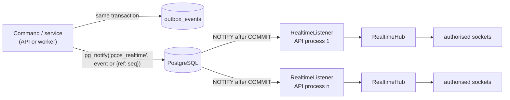

# Realtime protocol (local WebSocket)

All realtime traffic stays inside the venue: devices open one WebSocket to the edge server, subscribe
to topics and receive committed domain events. Sources: `packages/types/src/realtime.ts` (protocol
types), `apps/api/src/realtime/hub.ts` (server), `packages/core/src/events.ts` and
`packages/core/src/runners/realtime-listener.ts` (delivery path), `packages/domain/src/access.ts`
(subscription rules), `apps/web/src/lib/realtime.ts` and `realtime-context.tsx` (client).

Related: [ARCHITECTURE.md](ARCHITECTURE.md#5-request-flow-of-a-tournament-command),
[LOCAL_NETWORK.md](LOCAL_NETWORK.md), [NETWORK_SECURITY.md](NETWORK_SECURITY.md),
[DEVICE_SETUP.md](DEVICE_SETUP.md), [OFFLINE_OPERATION.md](OFFLINE_OPERATION.md).

---

## 1. Delivery path

1. `publishEvents()` inserts one `outbox_events` row per event and, for events that are not marked
   `realtime: false`, calls `pg_notify('pcos_realtime', payload)` inside the same transaction.
2. PostgreSQL delivers notifications only after `COMMIT`; a rolled-back change is never broadcast.
3. The payload is the JSON `RealtimeEvent`. If it exceeds 7 500 bytes (the `pg_notify` limit is
   8 000) the payload is `{"ref": seq}` and the listener re-reads the event from `outbox_events`.
4. Every API process runs one `RealtimeListener` on a dedicated `pg.Client`
   (`application_name = pcos-realtime`) with `LISTEN pcos_realtime`. On connection loss it reconnects
   with backoff 0.5 s doubling to 10 s; after a successful **re**connect the hub broadcasts a resync
   event (section 6), because notifications sent while disconnected are lost.
5. Changes made by the worker (automatic level changes, WAN status) reach sockets the same way.

Events with `realtime: false` (`tournament.created`, `tournament.configured`, `player.created`,
`player.updated`, `player.anonymized`) are written to the outbox only (for notifications and cloud sync).

---

## 2. Endpoints and connection handshake

| Endpoint | Notes |
|---|---|
| `GET /ws` (upgrade) | Primary path; Caddy proxies it to the API with `flush_interval -1`. |
| `GET /api/v1/ws` (upgrade) | Same handler (reached through the `/api/*` proxy rule). |

The hub attaches to the API's HTTP server (`noServer` mode; other upgrade paths are ignored).
Upgrade handling, in order:

1. **Client IP** is computed with `proxy-addr` and the same `TRUST_PROXY` list as the REST API.
2. **Per-IP limits**: at most 120 upgrade attempts per 60 s (shared rate limiter, Redis if configured)
   → `HTTP 429 Too Many Requests`; at most 64 concurrent connections per IP in this API process →
   `HTTP 429 Too Many Connections`.
3. **Session cookie** `pcos_session`, if present:
   - **Origin check (CSWSH protection)**: when the request carries an `Origin` header, its host must
     equal the `Host` header, the first `X-Forwarded-Host` value, or the host of an entry in
     `ALLOWED_ORIGINS`; otherwise `HTTP 403 Forbidden`. Requests without `Origin` (non-browser
     clients) pass.
   - The session is resolved; principal `staff` if the user holds staff roles in the session's
     organization, else `player` if the user has a player profile there. An invalid or expired cookie
     leaves the connection anonymous (it is not rejected).
4. **Device token**: only if the principal is still anonymous, `?display=<token>` or
   `?kiosk=<token>` is resolved against `display_tokens` (SHA-256 hash, not revoked). The principal
   kind (`display` or `kiosk`) comes from the token row's `kind`, not from the parameter name. An
   unknown or revoked token → `HTTP 401 Unauthorized`. Device-token connections have no cookie, so no
   Origin check applies.
5. Otherwise the connection is `anonymous`.

Server errors during the upgrade return `HTTP 500`.

---

## 3. Connection lifecycle

### Messages

All frames are JSON text frames. Binary frames and invalid JSON are answered with
`{"type":"error","code":"BAD_MESSAGE"}`. Maximum incoming frame size is 8 KiB.

Client → server (`ClientMessage`, zod-validated):

| Message | Fields | Server reaction |
|---|---|---|
| `hello` | `deviceId?` (UUID), `deviceType?` (`DEVICE_TYPES`), `appVersion?` (≤ 40 chars) | Remembers the device id (used for dealer table restrictions and device disconnects). For staff connections the device is registered/refreshed; a revoked device is closed with code `4403`. |
| `subscribe` | `topic` (≤ 80 chars), `requestId?` (≤ 40 chars) | `subscribed` or `error` (section 4). |
| `unsubscribe` | `topic` | Removes the subscription; always answers `unsubscribed`. |
| `ping` | `t` (client epoch ms) | `pong` with `t` echoed and `serverTime`. |

Server → client (`ServerMessage`):

| Message | Fields |
|---|---|
| `welcome` | `connectionId`, `serverTime` (epoch ms), `principal` (`staff`, `player`, `display`, `kiosk`, `anonymous`), `edge` (`EdgeStatusPayload`: `nodeId`, `status`, `wanOnline`, `lastWanSeenAt`, `telegram`, `cloudSync {enabled, pending, lastSyncAt}`, `serverTime`) |
| `subscribed` | `topic`, `requestId?` |
| `unsubscribed` | `topic` |
| `event` | `event` (`RealtimeEvent`, section 5) |
| `pong` | `t`, `serverTime` |
| `error` | `code` (`BAD_MESSAGE`, `TOO_MANY_SUBSCRIPTIONS`, `NOT_FOUND`, `FORBIDDEN`), `message`, `topic?`, `requestId?` |

`welcome` is always the first message. Its `serverTime` lets the client compute its clock offset
immediately; `edge` gives the WAN/Telegram/cloud-sync state for the connectivity banner.

### Heartbeat

Every 25 s the server sends a WebSocket ping to each connection; a connection that has not answered
the previous ping with a pong is terminated. Independently, the web client sends an application-level
`ping` every 10 s to refine the clock offset.

### Session revalidation and forced closes

| Trigger | Action |
|---|---|
| Every 60 s, for connections opened with a session cookie | The session is resolved again; if it is gone (logout, expiry, revocation) or its id changed, close `4401 "session expired"`. |
| Event `session.revoked` with `data.userId` (staff roles/status/password changed) | Close every connection of that user, `4401 "session revoked"`. |
| Event `device.updated` with `disconnect: true` (device revoked or disconnected by an administrator) | Close staff connections whose `hello.deviceId` matches, `4403 "device disconnected by administrator"`. |
| `hello` from a revoked staff device | `4403 "device revoked"`. |
| API shutdown | `1001 "server shutting down"`. |

Display and kiosk connections are not revalidated: revoking a display token
(`POST /api/v1/display-tokens/:id/revoke`) publishes no event and does not close an already open
socket; the token is rejected on the next upgrade and by the REST state endpoint.

---

## 4. Topics and authorization

Topic names are `kind:uuid` (`parseTopic`: `organization`, `venue`, `tournament`, `table`,
`display`). Each subscription is authorised individually by `authorizeSubscription(principal, target)`
and stored with an **audience**:

| Topic | Staff | Display / kiosk token | Player / anonymous |
|---|---|---|---|
| `organization:{id}` | same organization (venue scope ignored) → `staff` | denied | denied |
| `venue:{id}` | venue accessible (respects `venue_ids`) → `staff` | token's venue → `public` | denied |
| `tournament:{id}` | venue accessible and `tournament.read` or `dealer.table.operate` → `staff` | token's venue, and the token's bound tournament if any → `public` | tournament `published` and not `PRIVATE` → `public` |
| `table:{id}` | venue accessible and `tournament.read` → `staff`; with only `dealer.table.operate`: allowed if the device named in `hello` is assigned to this table, has no assigned table, or no `hello` device id was sent → `staff` | denied | denied |
| `display:{id}` | `display.manage` and venue accessible → `staff` | own token id → `public` | denied |

Super admins pass every venue check. The default `DEALER` role includes `tournament.read`, so the
device-assignment restriction on `table:{id}` topics only applies to custom roles that have
`dealer.table.operate` without `tournament.read`. Other details:

- Unknown or malformed topics → `error NOT_FOUND`; denied → `error FORBIDDEN` with the reason.
- At most 64 subscriptions per connection (`TOO_MANY_SUBSCRIPTIONS`).
- Topic targets (organization/venue/visibility of the tournament) are cached for 10 s; a
  `tournament.updated` event drops the cache entry of that tournament. Existing subscriptions are not
  re-authorised when a tournament's visibility changes.
- No code publishes events to `display:{id}` topics; the web app does not subscribe to `table:{id}` or
  `display:{id}` topics (dealer pages use the tournament topic).

### Audience filtering

Every event has an audience. A subscription with audience `staff` receives all events of the topic; a
`public` subscription receives only events with audience `public` (`audienceAllows`). An event
listed under several topics is sent at most once per connection. Events with topic `"*"` are sent to
every open connection regardless of subscriptions and audience (used only by `edge.status.updated`).

---

## 5. Events

Envelope (`RealtimeEvent`):

| Field | Meaning |
|---|---|
| `name` | Event name (list below) |
| `topics` | Topics the event is published on |
| `audience` | `public` or `staff` |
| `data` | Event-specific payload |
| `tournamentVersion` | Tournament version after the change (tournament events); every event of one command carries the same value |
| `occurredAt` | ISO timestamp of the change |
| `seq` | `outbox_events.seq` (absent on the synthetic resync event) |

Tournament command events are always published on `tournament:{id}` plus the topics listed.

| Event | Emitted by | Extra topics | Audience | `data` |
|---|---|---|---|---|
| `tournament.updated` | Commands that change tournament fields or statistics; automatic level change with status change | `venue:{id}` | public | `tournamentId`, `changes` (only public fields: status, name, startAt, published, publicVisibility, lateRegistrationClosed, startedAt, finishedAt, finalizedAt, cancelledAt, pausedFromStatus), `stats?` |
| `tournament.updated` | `PATCH /tournaments/:id` | `venue:{id}` | public | `tournamentId`, `changes` (name, startAt, publicVisibility, maxPlayers), `configChanged: true` |
| `tournament.updated` | `PUT /structures/:id/levels` of a tournament's structure | `venue:{id}` | public | `tournamentId`, `levelsChanged: true` |
| `tournament.updated` | Tournament creation (not on the tournament topic) | `venue:{id}`, `organization:{id}` only | staff | `tournamentId`, `created: true`, `name` |
| `clock.updated` | Clock commands, `START_TOURNAMENT`, finish/cancel/reopen, auto-advance | `venue:{id}` | public | `tournamentId`, `clock` (`ClockView`), `reason` (command type or `AUTO_ADVANCE`) |
| `registration.created` | `REGISTER_PLAYER` | – | staff | `registrationId`, `playerId`, `playerName`, `status`, `source`, `waitlistPosition` |
| `registration.updated` | Any registration status change | – | staff | `registrationId`, `playerId`, `status`, `previousStatus` |
| `entry.created` | New entry | – | staff | `entryId`, `playerId`, `playerName`, `entryNumber`, `type` |
| `entry.updated` | Rebuy, add-on, chip adjustment, bounty, voids | – | staff | `entryId` plus transaction or void details |
| `seat.assigned` / `seat.moved` | `applyMove` | `table:{id}` (destination and origin) | public if `publicSeatList` flag, else staff | movement id, entry/player, player name, from/to table id, number and seat, reason |
| `seat.released` | Elimination, void, undo of a seat assignment | `table:{id}` | as above | entry/player, table, seat, reason |
| `table.updated` | Table created/closed/broken, seat lock, dealer button, presence, movement confirmation | `table:{id}` (not for created tables) | public for create/close/break, otherwise staff | table-specific fields |
| `player.eliminated` | `ELIMINATE_PLAYERS` | – | public | `entryId`, `playerId`, `playerName`, `position`, `tableNumber`, `seatNumber`, `eliminatedByPlayerName`, `remaining` |
| `player.restored` | `RESTORE_PLAYER`, undo of an elimination | – | public | `entryId`, `playerId`, `playerName`, `tableNumber`, `seatNumber`, `reason` |
| `result.updated` | `FINISH_TOURNAMENT`, `FINALIZE_RESULTS`, `CORRECT_RESULT` | – | public | `status` (`PROVISIONAL`/`FINALIZED`) and `top`, `players`/`seasonId` or `corrected`/`revision` |
| `leaderboard.updated` | Finalize / correct with league | `organization:{id}` | public | `seasonId`, `leagueId`, `top` (20), `changes` |
| `announcement.created` | `POST /announcements` (not a command) | `tournament:{id}` and/or `venue:{id}` | public | `AnnouncementView` |
| `floor.request.created` / `floor.request.updated` | Dealer commands, `RESOLVE_FLOOR_REQUEST` | `table:{id}` | staff | request id, table, kind, seat, message / status |
| `edge.status.updated` | WAN state change, Telegram integration status change, listener reconnect | `"*"` | public | `EdgeStatusPayload`, or `{resync: true}` |
| `device.updated` | Device edit/revoke/restore/disconnect | `organization:{id}` | staff | `deviceId`, `updated` / `revoked` / `disconnect` |
| `session.revoked` | Staff member updated (roles, status, password) | `organization:{id}` | staff | `userId` (also closes that user's sockets) |
| `organization.updated` | Organization settings changed | `organization:{id}` | staff | `settingsChanged: true` |
| `notification.created` | Declared in `REALTIME_EVENTS`; never emitted (not implemented) | – | – | – |

---

## 6. Ordering, gaps and resync

- Commands of one tournament are serialised by the tournament row lock, so tournament versions
  commit in increasing order. PostgreSQL delivers notifications to a listener in commit order and the
  hub dispatches inline events synchronously in arrival order. `tests/e2e/lan.test.ts` asserts that
  staff, anonymous and display sockets see `tournamentVersion` in non-decreasing order.
- Exception: events sent by reference (payload > 7 500 bytes) are resolved with a database read before
  dispatch and can therefore be delivered after events that committed later.
- There is no replay. `seq` is informational; missed events are recovered by reloading snapshots:
  - after every (re)connect the client increments its `epoch` and its data hooks refetch;
  - after the API's `LISTEN` connection reconnects, the hub sends
    `edge.status.updated {resync: true}` on topic `"*"` to every socket, which also increments
    `epoch`;
  - the staff snapshot hook refetches when an event's `tournamentVersion` is more than one ahead of
    the cached snapshot version;
  - snapshots and device state are also refetched every 60 s.

---

## 7. Client implementation (`apps/web`)

### `RealtimeClient` (`src/lib/realtime.ts`)

- One connection per page, created by `RealtimeProvider`. URL: `NEXT_PUBLIC_WS_URL` if set, else
  `ws(s)://<current host>/ws`; displays and kiosks pass `{display: token}` / `{kiosk: token}` as query
  parameters.
- On open: resets backoff, sends `hello` (device id from `localStorage`, device type, app version),
  re-subscribes all topics, increments `epoch`, starts pinging every 10 s.
- Reconnect: delay 0.5 s doubling up to 8 s with ±25 % jitter; immediate reconnect when the browser
  reports `online` or the tab becomes visible.
- Subscriptions are reference-counted per topic (`subscribe()` returns the unsubscribe function);
  `requestId` is a short per-connection counter (`s1`, `s2`, …; topic names are longer than the
  40-char limit). `subscribed` replies are ignored; `error` replies are logged with `console.warn`.
- **Server clock offset**: initial offset from `welcome.serverTime`; each `pong` produces a sample
  `offset = serverTime + rtt/2 − receivedAt` (`estimateOffset`); the last 8 samples are kept and the
  one with the lowest round-trip time is used. `now()` returns `Date.now() + offset`.
- **Connectivity state** (`ConnectivityState`): `LAN_DISCONNECTED` if `navigator.onLine` is false,
  `SERVER_UNREACHABLE` if the socket is not open, `WAN_OFFLINE` if `edge.wanOnline` is false,
  `SYNC_PENDING` if cloud sync is enabled with pending events, otherwise `LOCAL_CONNECTED`.
  `edge.status.updated` events update the stored edge status.

### Hooks (`src/lib/realtime-context.tsx`, `src/lib/queries.ts`, `src/lib/clock.ts`)

| Hook | Behaviour |
|---|---|
| `useTopicEvents(topics, handler)` | Subscribes to the topics and calls the handler for events on them (or on `"*"`). |
| `useServerNow(250)` | Server-corrected time, re-rendered every 250 ms. |
| `useDerivedClock(clock, levels)` | Runs `deriveClock` from `@pcos/domain` on the persisted anchor with server-corrected time; the browser only animates. |
| `useTournamentSnapshot(id)` | Staff snapshot. `clock.updated` patches the clock; `tournament.updated` patches changes and stats (refetch if `levelsChanged`/`configChanged`); other events trigger a debounced (150 ms) refetch; version gap or new `epoch` → refetch. |
| `usePublicLive(idOrSlug)` | Public projection for player pages and TVs; similar patching, `announcement.created` is prepended, debounce 300 ms. |
| `useCommand(id)` | Sends commands with `expectedVersion` from the cached snapshot and a fresh `clientOperationId`; on `VERSION_CONFLICT` shows a warning and reloads the snapshot. |

### Displays and kiosks (`src/components/display/device-state.ts`)

The device fetches `GET /api/v1/display/{token}/state` (every 60 s, retried with backoff except on
401/403/404), subscribes to `venue:{id}` to follow tournament switches and venue-wide announcements,
and to the current tournament through `usePublicLive`. It refetches its state when a
`tournament.updated` with `created` or a status change arrives. Note that tournament-creation events
are published with `staff` audience, so display/kiosk (public) subscriptions never receive them; the
60 s refetch picks up new tournaments.

---

## 8. Operational notes

- Each API process keeps its own connections, per-IP connection count and topic cache; with several
  API processes every process receives every notification through its own `LISTEN`.
- The staff UI shows WAN/sync state from `welcome.edge` and `edge.status.updated`; local operation
  does not depend on it ([OFFLINE_OPERATION.md](OFFLINE_OPERATION.md)).
- `GET /api/v1/edge/diagnostics` lists connected sockets (connection id, device id, user id, principal
  kind, IP, connection time, subscription count); `GET /api/v1/devices` marks devices with an open
  socket as connected.
