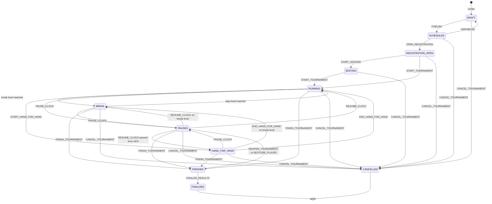

# Tournament state machine

Sources: `packages/domain/src/state-machine.ts`, `clock.ts`, `levels.ts`, `entry-rules.ts`,
`results.ts`, `undo.ts`; handlers in `packages/core/src/tournaments/handlers/*.ts`; executor
`packages/core/src/tournaments/executor.ts`. Every change described here is a tournament command sent
to `POST /api/v1/tournaments/:id/commands` ([API.md](API.md#7-tournament-command-catalogue)); the
executor flow is described in [ARCHITECTURE.md](ARCHITECTURE.md#5-request-flow-of-a-tournament-command).
Entities are described in [DOMAIN_MODEL.md](DOMAIN_MODEL.md), seating in [SEATING_ENGINE.md](SEATING_ENGINE.md).

---

## 1. Tournament statuses

| Status | Meaning |
|---|---|
| `DRAFT` | Created, not visible to players. |
| `SCHEDULED` | Published (`published = true`); visible on public pages unless `PRIVATE`. |
| `REGISTRATION_OPEN` | Players may register themselves. |
| `SEATING` | Optional seat-draw phase before the start. |
| `RUNNING` | Clock running on a play level. |
| `BREAK` | Clock running on a break level. |
| `PAUSED` | Clock paused; `paused_from_status` remembers the previous status. |
| `HAND_FOR_HAND` | Hand-for-hand play; the clock keeps running. |
| `FINISHED` | Play is over; results are `PROVISIONAL`. |
| `FINALIZED` | Results are final; league points applied. Terminal. |
| `CANCELLED` | Terminal. |

Groups used by the rules: *live* = `RUNNING`, `BREAK`, `PAUSED`, `HAND_FOR_HAND`; *pre-start* =
`DRAFT`, `SCHEDULED`, `REGISTRATION_OPEN`, `SEATING`; *closed* = `FINISHED`, `FINALIZED`, `CANCELLED`.
The status column can only be changed by commands; there is no generic "set status" operation.

---

## 2. Lifecycle transitions

`LIFECYCLE_TRANSITIONS` defines the allowed source states. A command issued in any other state fails
with `409 INVALID_STATE` (reported as `VERSION_CONFLICT` if the command's `expectedVersion` was stale).

| Command | From | To | Additional behaviour |
|---|---|---|---|
| `PUBLISH` | `DRAFT` | `SCHEDULED` | Validates the structure: at least one play level, no break first, no consecutive breaks, big blind never decreasing → otherwise `422 RULE_VIOLATION`. Sets `published = true`. |
| `UNPUBLISH` | `SCHEDULED` | `DRAFT` | Rejected while any registration is `RESERVED`, `REGISTERED` or `WAITLISTED`. Sets `published = false`. |
| `OPEN_REGISTRATION` | `SCHEDULED` | `REGISTRATION_OPEN` | – |
| `START_SEATING` | `REGISTRATION_OPEN` | `SEATING` | With `draw: true` (default) seats every unseated active entry ([SEATING_ENGINE.md](SEATING_ENGINE.md#2-initial-seating)). |
| `START_TOURNAMENT` | `REGISTRATION_OPEN`, `SEATING` | `RUNNING` (`BREAK` if level 0 is a break) | Requires at least one level. Sets `started_at`, seats all unseated active entries, starts the clock at level index 0. |
| `PAUSE_CLOCK` | `RUNNING`, `BREAK`, `HAND_FOR_HAND` | `PAUSED` | Stores `paused_from_status`; clock must be `RUNNING`. |
| `RESUME_CLOCK` | `PAUSED` | `HAND_FOR_HAND` if paused from hand-for-hand, else `BREAK`/`RUNNING` by level type | Clock must be `PAUSED`; clears `paused_from_status`. |
| `START_HAND_FOR_HAND` | `RUNNING` | `HAND_FOR_HAND` | Not allowed during `BREAK`. |
| `END_HAND_FOR_HAND` | `HAND_FOR_HAND` | `RUNNING` (`BREAK` if on a break level) | While `PAUSED` with `paused_from_status = HAND_FOR_HAND` it only changes `paused_from_status` to `RUNNING`. |
| `FINISH_TOURNAMENT` | live | `FINISHED` | Computes provisional results (section 9); closes late registration; clock → `FINISHED`. |
| `REOPEN_TOURNAMENT` | `FINISHED` | `PAUSED` | Deletes results, clears `finish_position` of active entries, clock → `PAUSED`; `paused_from_status = RUNNING`; audited with the reason. |
| `FINALIZE_RESULTS` | `FINISHED` | `FINALIZED` | Results → `FINALIZED`, league points (section 9). |
| `CANCEL_TOURNAMENT` | every status except closed ones | `CANCELLED` | Sets `cancelled_at`; a running/paused clock → `FINISHED`; audited with the reason. |

Implicit transitions:

- **Level type**: while the status is `RUNNING` or `BREAK`, entering a break level sets `BREAK` and
  entering a play level sets `RUNNING` (`statusForLevel`). This happens on automatic level changes
  and on clock commands. `PAUSED` and `HAND_FOR_HAND` are never changed by the level type.
- **Restoring an eliminated player while `FINISHED`** (`RESTORE_PLAYER`, or undo of an elimination)
  deletes the results and moves the tournament to `PAUSED` (`paused_from_status = RUNNING`). In
  `FINALIZED` it is rejected ("use a result correction instead").

Registration does not open or close automatically at `registration_open_at` /
`registration_close_at`; those fields are informational (not implemented). Reaching the last level
does not finish the tournament; `FINISH_TOURNAMENT` is always explicit.

### Operational commands per status

`packages/domain/src/state-machine.ts` defines `OPERATION_STATES` (for example `ELIMINATE_PLAYERS`
only in live states, `CHECK_IN` from `REGISTRATION_OPEN` on) and `assertOperationAllowed()`. **This
table is not enforced**: neither the executor nor any handler calls `assertOperationAllowed()`. The
effective guards are the per-handler checks listed below.

| Command group | Effective status guard in the handler |
|---|---|
| Clock (`NEXT_LEVEL`, `PREVIOUS_LEVEL`, `SET_LEVEL`, `ADJUST_CLOCK`, `SET_REMAINING`) | Clock must be `RUNNING` or `PAUSED` (i.e. after `START_TOURNAMENT` and before finish/cancel). |
| `REGISTER_PLAYER` (player) | Tournament published and not `PRIVATE`, `playerRegistration` flag on, status `REGISTRATION_OPEN` or live with late registration open. |
| `REGISTER_PLAYER` (staff) | Rejected only when live and late registration is closed; accepted in every other status. |
| `CHECK_IN` / `CREATE_ENTRY` | Creating an entry requires late registration to be open (closed statuses → rejected; pre-start → allowed). Check-in without an entry has no status guard. |
| `REBUY`, `ADD_ON` | Live status required (rule check). |
| `RESTORE_PLAYER` | Rejected in `FINALIZED`. |
| `CORRECT_RESULT` | Needs result rows, which exist only in `FINISHED` and `FINALIZED`. |
| Seating/table commands, `ELIMINATE_PLAYERS`, `CHIP_ADJUSTMENT`, `VOID_*`, `CANCEL_REGISTRATION`, `UNDO_CHECK_IN`, `MARK_NO_SHOW`, `PROMOTE_WAITLIST`, `CLOSE/REOPEN_LATE_REGISTRATION`, dealer commands | No tournament status guard (entity-level checks only). |

---

## 3. Registration and entry statuses

### Registrations (`tournament_registrations.status`)

| Transition | Trigger |
|---|---|
| → `REGISTERED` | `REGISTER_PLAYER` with free capacity. |
| → `RESERVED` | `REGISTER_PLAYER` with `reserveOnly: true` (staff) and free capacity. |
| → `WAITLISTED` | `REGISTER_PLAYER` when registrations in `RESERVED`, `REGISTERED`, `CHECKED_IN`, `PLAYING`, `ELIMINATED` already reach `max_players`; gets the next `waitlist_position`. |
| `WAITLISTED` → `REGISTERED` | `PROMOTE_WAITLIST` (staff; allowed over capacity, audited as `CAPACITY_OVERRIDE`), or automatically when `CANCEL_REGISTRATION`/`MARK_NO_SHOW` frees a place (oldest by position, then registration time). |
| `REGISTERED`/`RESERVED` → `CHECKED_IN` | `CHECK_IN`; also implicitly by `CREATE_ENTRY` (requires `registration.checkin`). |
| `CHECKED_IN` → `REGISTERED` | `UNDO_CHECK_IN` (only while no entry exists). |
| → `PLAYING` | First entry created (`CHECK_IN` with `createEntry`, `CREATE_ENTRY`), or a player restored. |
| `PLAYING` → `ELIMINATED` | `ELIMINATE_PLAYERS` of the entry. |
| `REGISTERED`/`RESERVED` → `NO_SHOW` | `MARK_NO_SHOW`. |
| → `CANCELLED` | `CANCEL_REGISTRATION`: players may cancel `RESERVED`/`REGISTERED`/`WAITLISTED`; staff also `CHECKED_IN`. A `PLAYING` registration must have its entry voided first. |
| after `VOID_ENTRY` | Recomputed: `PLAYING` if another active entry exists, `ELIMINATED` if other non-voided entries exist, otherwise `CHECKED_IN`. |

A player can hold only one registration per tournament that is not `CANCELLED`/`NO_SHOW` (database
index; a second attempt returns `409 DUPLICATE`). `BANNED` and `MERGED` players cannot register.

### Entries (`tournament_entries.status`)

`ACTIVE` → `ELIMINATED` (`ELIMINATE_PLAYERS`) → `ACTIVE` (`RESTORE_PLAYER` / undo). `ACTIVE` or
`ELIMINATED` → `VOIDED` (`VOID_ENTRY`, undo of `CREATE_ENTRY`/`CHECK_IN`). A player has at most one
`ACTIVE` entry (database index). Every entry starts with a `BUY_IN` transaction of `starting_stack`
chips and `buy_in.amount + buy_in.fee` cents. Entry type is `INITIAL` for the first non-voided entry,
`REENTRY` afterwards.

---

## 4. Clock model

### Persisted anchor

`tournament_clock_states` stores a small anchor, never a ticking counter:

| Field | Set when | Meaning |
|---|---|---|
| `clock_status` | always | `NOT_STARTED`, `RUNNING`, `PAUSED`, `FINISHED` |
| `current_level_index` | always | Index into the structure's levels (0-based, breaks included) |
| `started_at` | `RUNNING` | Wall-clock instant at which the current level would have started had it never been paused |
| `paused_at`, `remaining_at_pause_ms` | `PAUSED`, `FINISHED` | Pause instant and time left in the level at that instant |

### Derived clock

`deriveClock(anchor, levels, now)` is a pure function used by the server and by browsers
(`apps/web/src/lib/clock.ts`, with server-corrected time from [REALTIME.md](REALTIME.md#3-connection-lifecycle)).

- `RUNNING`: starting from `current_level_index` and `started_at`, it walks forward over every level
  whose duration has fully elapsed. On the last level the remaining time holds at 0 and
  `structureComplete = true`; the status stays `RUNNING`.
- `PAUSED`: remaining = `remaining_at_pause_ms` (or the full duration if null).
- `FINISHED`: remaining = `remaining_at_pause_ms` (or 0).
- `NOT_STARTED`: remaining = full duration of the current level.

Derived values include `levelIndex`, `playLevelNumber` (1-based count of play levels up to the index;
a break reports the number of the play level before it), `isBreak`, `remainingMs`, `elapsedMs`,
`levelEndsAt`, `nextLevelIndex`, `nextBreakIndex` and `msUntilNextBreak`.

Because the anchor is a wall-clock instant, a server restart does not reset the level; time elapsed
while the server was down is counted.

### Auto-advance materialisation

The worker's `ClockTicker` checks every 500 ms each clock in `RUNNING`. When the derived level differs
from `current_level_index`, `executor.autoAdvance()`:

1. locks the tournament row (`FOR UPDATE`) and re-computes `materialize(anchor)`: the new anchor has
   the derived level index and `started_at = levelEndsAt − duration` (the exact boundary, not "now",
   so no drift accumulates);
2. increments `tournaments.version` and the clock row `version`, and aligns `RUNNING`/`BREAK`;
3. inserts an `operational_actions` row of type `CLOCK_AUTO_ADVANCE` with `affected_keys =
   ["clock:auto"]`;
4. publishes `clock.updated` (`reason: "AUTO_ADVANCE"`) and, if the status changed,
   `tournament.updated`.

Every command also materialises the anchor before its handler runs, so handlers always see the
current level. If the worker is stopped, clients still show the correct countdown; the persisted level,
status and level-based rules catch up at the next command or tick.

### Breaks

Breaks are levels of type `BREAK` in the structure. Entering one switches `RUNNING` → `BREAK` (and
back on the next play level). Break-sensitive rules: late registration and level-based re-entry stay
open during the break after the last allowed level (the break reports the previous level's number),
and an add-on with `afterLevel = N` is available during play level N and the break after it.

### Clock commands

| Command | Payload | Effect |
|---|---|---|
| `PAUSE_CLOCK` | – | Anchor → `PAUSED` with the derived level and remaining time. |
| `RESUME_CLOCK` | – | `started_at = now − (duration − remaining)`. |
| `NEXT_LEVEL` / `PREVIOUS_LEVEL` | `fromLevelIndex?` | Jump to the adjacent level with its full duration, keeping `RUNNING`/`PAUSED`. Fails on the last/first level. |
| `SET_LEVEL` | `levelIndex` | Jump to an absolute level with its full duration. |
| `ADJUST_CLOCK` | `deltaSeconds` (±6 h), `fromLevelIndex?` | Remaining time + delta, floored at 0. |
| `SET_REMAINING` | `remainingSeconds` (0–6 h), `fromLevelIndex?` | Set the remaining time of the current level (may exceed its nominal duration). |

All of them require the clock to be `RUNNING` or `PAUSED` (except that `PAUSE_CLOCK`/`RESUME_CLOCK`
additionally require `RUNNING`/`PAUSED` respectively) and touch the conflict key `clock`.

### `fromLevelIndex` guard

Level-relative commands (`NEXT_LEVEL`, `PREVIOUS_LEVEL`, `ADJUST_CLOCK`, `SET_REMAINING`) may carry
the level index the operator was looking at. If the derived level index after materialisation differs,
the command fails with `409 VERSION_CONFLICT` ("the clock is now at level index …") instead of skipping
a level or adjusting the wrong one. This is necessary because the auto-advance writes the key
`clock:auto`, which never overlaps the key `clock` used by REBASE conflict detection. `SET_LEVEL`
(absolute) has no guard. The floor clock panel (`apps/web/src/components/floor/clock-panel.tsx`)
always sends `fromLevelIndex`.

### Structure edits during play

`PUT /structures/:id/levels` on a tournament's own structure is allowed while it runs, but levels up
to and including the current one must stay identical (type, blinds, ante, duration); otherwise
`422 RULE_VIOLATION`. The materialised anchor is persisted first; the tournament version is bumped and
`tournament.updated` with `levelsChanged: true` is published. After `FINISHED`/`FINALIZED`/`CANCELLED`
the structure is frozen.

---

## 5. Late registration

`isLateRegistrationOpen()` (`packages/domain/src/entry-rules.ts`) decides whether new players may
still join:

1. Closed status → closed.
2. `late_registration_closed = true` → closed. The flag is set by `CLOSE_LATE_REGISTRATION` and by
   `FINISH_TOURNAMENT`, cleared by `REOPEN_LATE_REGISTRATION` (each rejects a no-op).
3. Pre-start status → open.
4. Live status: `late_registration_policy.enabled = false` → closed; otherwise by `closeMode`:

| `closeMode` | Open while |
|---|---|
| `LEVEL` (default, `untilLevel` default 6) | `playLevelNumber ≤ untilLevel` (includes the break after that level); open if `untilLevel` is null |
| `TIME` | `now < untilTime`; open if `untilTime` is null |
| `MANUAL` | until `CLOSE_LATE_REGISTRATION` |

The rule is evaluated whenever it is needed (registration, entry creation, elimination positions,
public `registrationOpen`); the `late_registration_closed` flag is not flipped automatically when the
level or time passes. The worker sends `LATE_REGISTRATION_CLOSING` Telegram notifications 1–10 minutes
before a `LEVEL`-mode close.

Late entrants are seated automatically according to the house rules
([SEATING_ENGINE.md](SEATING_ENGINE.md#3-late-registration-and-new-entries)).

---

## 6. Re-entry, rebuy, add-on, bounty

### New entry / re-entry (`decideNewEntry`)

Used by `CHECK_IN` (with `createEntry`) and `CREATE_ENTRY`:

- Registration `CANCELLED`/`NO_SHOW` → rejected; `WAITLISTED`/`RESERVED` → rejected ("promote/confirm
  it first"; `CHECK_IN` converts `RESERVED` to `CHECKED_IN` first). An `ELIMINATED` registration is
  treated as `PLAYING`.
- The player already has an `ACTIVE` entry → rejected.
- Late registration closed → rejected.
- No non-voided entry yet → `INITIAL`.
- Otherwise a re-entry: requires `format = REENTRY` or `reentry_policy.enabled`; `maxReentries`
  (null = unlimited) counts non-voided entries minus one; `closeMode`:
  `WITH_LATE_REGISTRATION` → allowed while late registration is open; `LEVEL` → additionally
  `playLevelNumber ≤ untilLevel`; `MANUAL` → behaves like `WITH_LATE_REGISTRATION` (no separate
  manual close exists; not implemented).
- A re-entry additionally requires the `entry.reentry` permission.

### Rebuy (`assertRebuyAllowed`)

`format = REBUY` or `rebuy_policy.enabled`; live status; entry `ACTIVE`; non-voided rebuys <
`maxRebuys` (null = unlimited); `playLevelNumber ≤ untilLevel` if set. `stackThreshold` is **not
enforced**: live stacks are not tracked, the handler passes no stack (comment in
`handlers/entries.ts`). Adds a `REBUY` transaction of `chips`/`amount`.

### Add-on (`assertAddonAllowed`)

`addon_policy.enabled`; live status; entry `ACTIVE`; non-voided add-ons < `maxAddons` (default 1);
if `afterLevel` is set, `playLevelNumber` must equal it (play level N and the following break). Adds
an `ADD_ON` transaction.

### Bounty

When `ELIMINATE_PLAYERS` names `eliminatedByEntryId` (an `ACTIVE` entry not in the busted list) and
`bounty_policy.enabled` or the format is `BOUNTY`/`PROGRESSIVE_KO`, the hunter receives a
`BOUNTY_WON` transaction (`chips 0`, `amount = bounty_policy.amount`) per busted entry. Restoring the
busted entry voids that transaction. Progressive bounty splitting is not implemented.

### Chip adjustments and voids

`CHIP_ADJUSTMENT` adds a signed `chips` transaction with a reason (entry must not be voided).
`VOID_TRANSACTION` marks a `REBUY`/`ADD_ON`/`CHIP_ADJUSTMENT`/`BOUNTY_WON` transaction voided and adds
a `VOID` row; a `BUY_IN` can only be reversed with `VOID_ENTRY`, which voids the entry and all its
transactions and releases its seat.

---

## 7. Eliminations and standings

`ELIMINATE_PLAYERS` takes 1–20 entries busted in the same hand, ordered by stack at the start of the
hand, largest first. Each receives a tournament-wide `elimination_seq`; the largest stack gets the
highest sequence (busts "last"). If late registration is closed at that moment, `finish_position` is
assigned immediately (`activeBefore − n + 1 + i`); while it is open positions stay null and are
computed at the finish. Seats are released, registrations become `ELIMINATED`, `player.eliminated`
(public) events are emitted. The result contains `remaining`, `lastPlayerStanding` and floor hints
(balance needed, severe imbalance, `haltPlay`, recommended table break). Eliminating an entry that is
already eliminated returns `INVALID_STATE` (→ `VERSION_CONFLICT` for a concurrent duplicate).

`computeStandings()` ranks players by their last entry: survivors first, then busted players by
descending `elimination_seq`.

---

## 8. Undo

Undo is a compensating command, `UNDO_ACTION { actionId, reason }` (permission `player.restore`).
History is never deleted: the undo is a new `operational_actions` row with `compensates_action_id`,
the original gets `compensated_by_action_id`, and an `UNDO` audit entry is written. An action that was
already undone, or that is itself an undo, cannot be undone (`422 RULE_VIOLATION`).

| Undone command | Compensation performed |
|---|---|
| `ELIMINATE_PLAYERS` | Restores each entry in reverse order: back to `ACTIVE`, registration `PLAYING`, bounty voided, original seat if still free and unlocked on an `OPEN`/`ACTIVE` table, otherwise an automatic seat. Fails if the player has re-entered meanwhile; rejected in `FINALIZED`; in `FINISHED` reopens to `PAUSED`. |
| `MOVE_PLAYER`, `APPLY_BALANCE` | Moves players back (reverse order) with reason `CORRECTION`; fails if the plan no longer validates (seat taken, player moved). |
| `ASSIGN_SEAT` | Releases the seat. |
| `REBUY`, `ADD_ON`, `CHIP_ADJUSTMENT` | Voids the transaction. |
| `CREATE_ENTRY` | Voids the entry. |
| `CHECK_IN` | Voids the entry created by it (if any) and returns `CHECKED_IN` → `REGISTERED`. |
| `REGISTER_PLAYER` | Cancels the registration if still `RESERVED`/`REGISTERED`/`WAITLISTED`. |
| `CANCEL_REGISTRATION`, `MARK_NO_SHOW` | Restores the previous status (a waitlist promotion made by the original is not reverted). |
| `PAUSE_CLOCK` / `RESUME_CLOCK` | Resumes / pauses (only if the clock is still paused / running). |
| `NEXT_LEVEL`, `PREVIOUS_LEVEL`, `SET_LEVEL`, `ADJUST_CLOCK`, `SET_REMAINING` | Restores the anchor captured before the command (a running clock keeps the time elapsed since); refused if the clock was paused/resumed in between. |
| `CLOSE_LATE_REGISTRATION` / `REOPEN_LATE_REGISTRATION` | Flips the flag back. |
| `START_HAND_FOR_HAND` | Ends hand-for-hand. |
| `SET_SEAT_LOCK` | Restores the previous lock state and reason. |

Not undoable (use the listed command instead): lifecycle commands (`PUBLISH` … `CANCEL_TOURNAMENT`,
`END_HAND_FOR_HAND`, `FINALIZE_RESULTS`), `UNDO_CHECK_IN`, `PROMOTE_WAITLIST`, `VOID_TRANSACTION`,
`VOID_ENTRY`, `ADD_TABLES`, `CLOSE_TABLE`, `SET_DEALER_BUTTON`, `APPLY_INITIAL_SEATING`, `BREAK_TABLE`,
`RESTORE_PLAYER`, `CORRECT_RESULT`, dealer commands, `RESOLVE_FLOOR_REQUEST`, and the
non-command rows `CLOCK_AUTO_ADVANCE` and `UPDATE_CONFIGURATION`. `GET /tournaments/:id/actions`
reports `undoable` per action.

`UNDO_ACTION` checks only `player.restore`, not the permission of the command being compensated.

---

## 9. Finishing and finalizing results

**`FINISH_TOURNAMENT { finalOrder? }`** (permission `tournament.finalize`, `STRICT`):

1. Standings in `FINAL` mode: if more than one player still has an active last entry, `finalOrder`
   must list all their entry ids in finishing order (1st first) — e.g. after a deal; otherwise
   `422 RULE_VIOLATION`.
2. `tournament_results` is replaced: one `PROVISIONAL` row per player with `position`, `entries`
   (non-voided entries) and `bounties` (number of eliminations credited to the player's entries).
3. Surviving entries get their `finish_position`.
4. Status `FINISHED`, `finished_at`, `late_registration_closed = true`, clock `FINISHED`;
   `result.updated` (public, top 10) is published.

**`REOPEN_TOURNAMENT { reason }`** reverses this (section 2).

**`FINALIZE_RESULTS`** (`STRICT`): results → `FINALIZED`, status `FINALIZED`, `finalized_at`. If the
tournament has a `season_id` whose league has a score rule, points are computed per result
(`position`, `entrants` = non-voided entries, `players` = unique players, `buyIn` = `buy_in.amount`
in cents, `reentries`, `bounties`, `entries`), a new leaderboard snapshot is computed over all
`FINALIZED` tournaments of the season plus this one (optionally best N results), and
`leaderboard.updated` is published. The notification fan-out then sends `RESULTS_FINALIZED` to each
player and `LEAGUE_POSITION_CHANGED` to players in the top 50 who entered or improved.

**`CORRECT_RESULT { playerId, position, reason }`** (`results.correct`): swaps the player with the
current holder of `position` (both rows get `revision + 1`), audited as `RESULT_CORRECTED`. In
`FINALIZED` it recomputes league points and the leaderboard. Corrections do not trigger
`RESULTS_FINALIZED` notifications.

---

## 10. Configuration changes

`PATCH /api/v1/tournaments/:id` (permission `tournament.edit`, exact `expectedVersion`) is not a
command but also bumps the version, writes an `UPDATE_CONFIGURATION` action (`affected_keys =
["tournament:config"]`) and publishes `tournament.updated` with `configChanged: true`.

| Tournament status | Editable fields |
|---|---|
| `DRAFT`, `SCHEDULED`, `REGISTRATION_OPEN` | All fields of `TournamentUpdateInput` (changing `structureId` copies the new structure and resets the clock level index to 0) |
| `SEATING` or live | `name`, `description`, `maxPlayers`, `expectedPlayers`, the late registration / re-entry / rebuy / add-on policies, `publicVisibility`, `seasonId`, `seriesId` |
| `FINISHED`, `FINALIZED`, `CANCELLED` | `name`, `description`, `seasonId`, `seriesId`, `publicVisibility` |

Changing `houseRulesProfileId` replaces the tournament's copy of the house rules (null → TDA 2026 style
defaults). A change of `startAt` triggers `TOURNAMENT_CHANGED` notifications to registered players.
